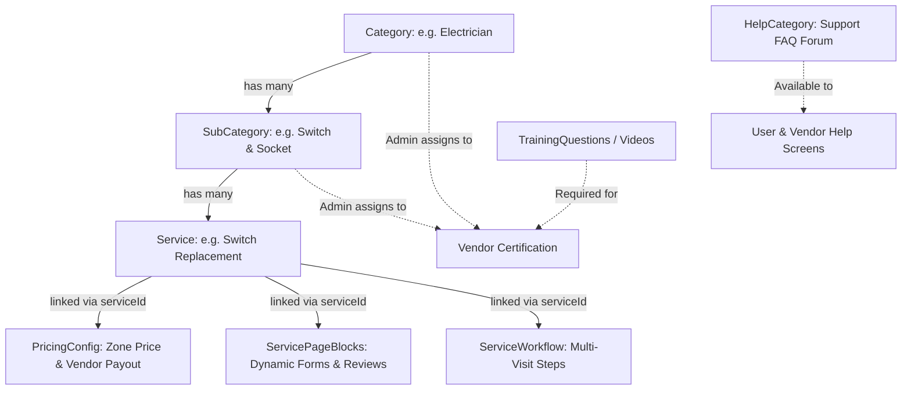

# Noyo Platform: Master Services, Categories, Forms & Static Data Catalog

**Document Purpose:** Complete clean catalog export of all user-facing services, service packages, admin vendor categories, dynamic forms/templates, help center forums/FAQs, partner training quizzes, workflows, and platform settings. Use this master document and the accompanying seeder script to restore a 100% operational, clutter-free MongoDB Atlas database.

**Platform Agency:** Appzeto Technologies  
**Client Platform:** Noyo  
**Generated Date:** 17/10/2026  
**Total Production Categories:** 30  
**Total Production Subcategories:** 55  
**Total Production Services:** 185  
**Total Pricing Configurations:** 1292  
**Total Dynamic Form Page Blocks:** 842  
**Total Multi-Visit Workflows & Steps:** 208  
**Total Help Center Categories & Questions:** 7 categories  
**Total Partner Training Modules:** 8 questions, 3 videos  

---

## Table of Contents
1. [Architecture & Linkage Overview](#1-architecture--linkage-overview)
2. [Master Categories Summary Table](#2-master-categories-summary-table)
3. [Detailed Services by Category](#3-detailed-services-by-category)
4. [Vendor Categories & Admin Assignment](#4-vendor-categories--admin-assignment)
5. [Help Center / Support Forums / FAQs](#5-help-center--support-forums--faqs)
6. [Partner Training & Certification Quizzes](#6-partner-training--certification-quizzes)
7. [Forms, Templates & Dynamic Service Blocks](#7-forms-templates--dynamic-service-blocks)
8. [Multi-Visit Service Workflows](#8-multi-visit-service-workflows)
9. [Global Platform Settings & Commission Rates](#9-global-platform-settings--commission-rates)
10. [Vendor Add-on Items & Parts Catalog](#10-vendor-add-on-items--parts-catalog)
11. [Wallet Credits, Subscriptions & Promo Codes](#11-wallet-credits-subscriptions--promo-codes)
12. [Professions, Cities & Operational Zones](#12-professions-cities--operational-zones)
13. [How to Seed Your New MongoDB Atlas Database](#13-how-to-seed-your-new-mongodb-atlas-database)

---

## 1. Architecture & Linkage Overview

The platform uses a relational document model inside MongoDB to power customer booking flows, dynamic forms, and vendor dispatching:



- **Customer View:** Customers browse by **Category** -> select **SubCategory** -> pick specific **Services** -> interact with dynamic forms/blocks (`servicepageblocks`) -> add to cart -> checkout.
- **Vendor View:** Vendors receive job alerts for bookings matching their assigned `categories` and `subCategories` in their registered operating zones. Before taking jobs, they certify through `trainingquestions` and `trainingvideos`.
- **Pricing Matrix:** Each service has one or more `PricingConfig` records defining customer price (`customerPrice`), vendor base payout (`vendorPayoutBase`), and platform commission.
- **Help Center Forums:** The `helpcategories` collection provides structured FAQ forums covering booking cancellations, refunds, rescheduling, technician guarantees, and safety policies.

---

## 2. Master Categories Summary Table

| # | Category Title | Slug | Type | Show on Home | Has Subcategories | Home Icon | Banner |
|---|---|---|---|:---:|:---:|:---:|:---:|
| 1 | **Electrician / Plumber / Carpenter** | `electrician-plumber-carpenter-box` | `service` | ✅ Yes | Yes | ✅ Yes | — |
| 2 | **Salon at Home** | `salon-at-home-box` | `service` | ✅ Yes | Yes | ✅ Yes | — |
| 3 | **Painting Service** | `painting-service-box` | `service` | ✅ Yes | Yes | ✅ Yes | — |
| 4 | **Construction & Renovation** | `construction-renovation` | `service` | ✅ Yes | Yes | ✅ Yes | — |
| 5 | **Solar Service** | `solar-service-box` | `service` | ✅ Yes | Yes | ✅ Yes | — |
| 6 | **Electrician** | `electrician` | `service` | No | Yes | ✅ Yes | ✅ Yes |
| 7 | **Plumber** | `plumber` | `service` | No | Yes | ✅ Yes | ✅ Yes |
| 8 | **Carpenter** | `carpenter` | `service` | ✅ Yes | Yes | ✅ Yes | — |
| 9 | **Engineer Consultant** | `engineer-consultant` | `service` | No | Yes | ✅ Yes | — |
| 10 | **Weekly Bathroom Cleaning** | `weekly-bathroom-cleaning` | `service` | No | Yes | ✅ Yes | — |
| 11 | **Solar Installation** | `solar-installation` | `service` | No | Yes | ✅ Yes | — |
| 12 | **Pest Control** | `pest-control` | `service` | No | Yes | ✅ Yes | — |
| 13 | **Home Cleaning** | `home-cleaning` | `service` | No | Yes | ✅ Yes | — |
| 14 | **Cleaning Service** | `cleaning-service-box` | `service` | ✅ Yes | Yes | ✅ Yes | — |
| 15 | **Sofa set** | `sofa-set` | `service` | No | Yes | ✅ Yes | ✅ Yes |
| 16 | **Massage** | `massage` | `service` | No | Yes | ✅ Yes | ✅ Yes |
| 17 | **Sofa Carpet and More** | `sofa-carpet-and-more` | `service` | No | Yes | ✅ Yes | — |
| 18 | **Tank Cleaning** | `tank-cleaning` | `service` | No | Yes | ✅ Yes | — |
| 19 | **Full House painting** | `full-house-painting` | `service` | No | Yes | ✅ Yes | — |
| 20 | **Salon For Women** | `salon-for-women` | `service` | No | Yes | ✅ Yes | — |
| 21 | **Salon for Men** | `salon-for-men` | `service` | No | Yes | ✅ Yes | — |
| 22 | **House Help** | `house-help-box` | `service` | ✅ Yes | Yes | ✅ Yes | — |
| 23 | **Pest Control** | `pest-control-box` | `service` | ✅ Yes | Yes | ✅ Yes | — |
| 24 | **Pest Control Service** | `pest-control-service` | `service` | No | Yes | ✅ Yes | — |
| 25 | **Pest Control Service** | `pest-control-service-box` | `service` | ✅ Yes | Yes | ✅ Yes | — |
| 26 | **House Keeping Services** | `house-keeping-services` | `service` | No | Yes | ✅ Yes | — |
| 27 | **House Keeping Services** | `house-keeping-services-box` | `service` | ✅ Yes | Yes | ✅ Yes | — |
| 28 | **Appliance repair** | `appliance-repair` | `service` | ✅ Yes | Yes | ✅ Yes | — |
| 29 | **Tv Unit** | `tv-unit` | `service` | ✅ Yes | Yes | ✅ Yes | — |
| 30 | **Painting** | `painting` | `service` | No | Yes | ✅ Yes | — |

---

## 3. Detailed Services by Category

### 1. Category: Electrician / Plumber / Carpenter
- **ID:** `6a6ee3a4b577f89b18e00204` | **Slug:** `electrician-plumber-carpenter-box` | **Type:** `service`
- **Show on Home:** Yes | **Order:** 0
- **Home Icon URL:** `https://res.cloudinary.com/deorxby43/image/upload/v1785652426/Doormeets/electrician-plumber-carpenter/icons/yykfxlo3f79rzcxcaalu.png`
- **Total Subcategories:** 0 | **Total Services:** 0

---

### 2. Category: Salon at Home
- **ID:** `6a6ee3dcb577f89b18e00246` | **Slug:** `salon-at-home-box` | **Type:** `service`
- **Show on Home:** Yes | **Order:** 49
- **Home Icon URL:** `https://res.cloudinary.com/deorxby43/image/upload/v1790485178/Doormeets/salon-at-home/icons/mkyz6gki6tzs65ay1nn0.png`
- **Total Subcategories:** 0 | **Total Services:** 0

---

### 3. Category: Painting Service
- **ID:** `6a6ee4ecb577f89b18e00414` | **Slug:** `painting-service-box` | **Type:** `service`
- **Show on Home:** Yes | **Order:** 4
- **Home Icon URL:** `https://res.cloudinary.com/deorxby43/image/upload/v1785652457/Doormeets/painting-service/icons/kbov9fxbgrbslqff2imx.png`
- **Total Subcategories:** 0 | **Total Services:** 0

---

### 4. Category: Construction & Renovation
- **ID:** `6a6ee632b577f89b18e00676` | **Slug:** `construction-renovation` | **Type:** `service`
- **Show on Home:** Yes | **Order:** 5
- **Home Icon URL:** `https://res.cloudinary.com/deorxby43/image/upload/v1785652783/Doormeets/construction-renovation/icons/ie2kk8y3s9w5japl9hnv.png`
- **Total Subcategories:** 0 | **Total Services:** 0

---

### 5. Category: Solar Service
- **ID:** `6a6ee688b577f89b18e006e4` | **Slug:** `solar-service-box` | **Type:** `service`
- **Show on Home:** Yes | **Order:** 6
- **Home Icon URL:** `https://res.cloudinary.com/deorxby43/image/upload/v1785652869/Doormeets/solar-installation/icons/gyvvhqzzdzf4hnq5m5kp.png`
- **Total Subcategories:** 0 | **Total Services:** 0

---

### 6. Category: Electrician
- **ID:** `6a6eeeadb577f89b18e00f78` | **Slug:** `electrician` | **Type:** `service`
- **Show on Home:** No | **Order:** 7
- **Home Icon URL:** `https://res.cloudinary.com/deorxby43/image/upload/v1785654872/Doormeets/electrician/icons/hqjqnrgbkq23wk5yuai8.png`
- **Banner URL:** `https://res.cloudinary.com/deorxby43/image/upload/v1785654883/Doormeets/electrician/banners/jg5q8wuwbvsfi2lbozhi.png`
- **Total Subcategories:** 9 | **Total Services:** 33

#### Subcategory 6.1: Switch & socket
- **Subcategory ID:** `6a6ef0aab577f89b18e011cc` | **Slug:** `switch-socket`
- **Icon URL:** `https://res.cloudinary.com/deorxby43/image/upload/v1789379592/Doormeets/subcategories/switch--socket/icons/tywel3obkrutvloeldgv.png`
- **Description:** Professional electrician services for all your electrical needs, including wiring, switch & socket repair, lighting installation, MCB replacement, fan installation, and electrical fault troubleshooting. Safe, reliable, and delivered by skilled experts.
- **Services Count:** 4

##### 🔹 Switch socket repair and replacement
- **Service ID:** `6a6efaf9b577f89b18e01bc5`
- **Slug:** `switch-socket-repair-and-replacement`
- **Service Type:** `package_base`
- **Status:** `active`
- **Icon URL:** `https://res.cloudinary.com/deorxby43/image/upload/v1785657510/service_banners/glevbpyjnddpezfpj9tm.png`
- **Rating:** ⭐ 4.9 (45 reviews)
- **Description:** Expert switch and socket repair, replacement, and installation for safe, reliable, and hassle-free electrical connections.
- **Customer Price:** ₹1 - ₹150 | **Vendor Payout:** ₹0 - ₹120
- **Vendor Acceptance Fee:** ₹14

##### 🔹 Switchboard repair  replacement
- **Service ID:** `6a6f1a2f8611f8f7de0bf3e2`
- **Slug:** `switchboard-repair-replacement`
- **Service Type:** `package_base`
- **Status:** `active`
- **Icon URL:** `https://res.cloudinary.com/deorxby43/image/upload/v1789365063/service_icons/pg92mr3o6aldbr2zqmlv.png`
- **Rating:** ⭐ 4.9 (28 reviews)
- **Description:** Professional switchboard repair, replacement, and installation services to ensure safe, secure, and reliable electrical connections.
- **Customer Price:** ₹99 - ₹239 | **Vendor Payout:** ₹79 - ₹191
- **Vendor Acceptance Fee:** ₹48

##### 🔹 Plug Replacement
- **Service ID:** `6a72eb8df78c482a41fd40d0`
- **Slug:** `plug-replacement`
- **Service Type:** `package_base`
- **Status:** `active`
- **Icon URL:** `https://res.cloudinary.com/deorxby43/image/upload/v1789364950/service_icons/r7ztqzu5rc7tlswy9tyy.png`
- **Rating:** ⭐ 4.9 (98 reviews)
- **Description:** Professional plug replacement for damaged or faulty plugs, ensuring safe, reliable, and secure electrical connections.
- **Customer Price:** ₹69 - ₹89 | **Vendor Payout:** ₹55 - ₹71
- **Vendor Acceptance Fee:** ₹14

##### 🔹 New Switchbox Installation
- **Service ID:** `6a72ed1df78c482a41fd4284`
- **Slug:** `new-switchbox-installation`
- **Service Type:** `package_base`
- **Status:** `active`
- **Icon URL:** `https://res.cloudinary.com/deorxby43/image/upload/v1789364711/service_icons/khu2o5d5dlrzerjfg6lc.png`
- **Rating:** ⭐ 4.9 (98 reviews)
- **Description:** Professional switchboard installation with safe wiring, precise fitting, and a clean finish for your home or office.
- **Customer Price:** ₹149 - ₹359 | **Vendor Payout:** ₹119 - ₹287
- **Vendor Acceptance Fee:** ₹30

#### Subcategory 6.2: Fan
- **Subcategory ID:** `6a6ef0edb577f89b18e0120d` | **Slug:** `fan`
- **Icon URL:** `https://res.cloudinary.com/deorxby43/image/upload/v1789379614/Doormeets/subcategories/fan/icons/badack42noamldwpj0ta.png`
- **Description:** Professional fan installation, repair, replacement, and maintenance services for smooth, safe, and efficient performance.
- **Services Count:** 7

##### 🔹 Ceiling Fan Repair
- **Service ID:** `6a72eddcf78c482a41fd4369`
- **Slug:** `ceiling-fan-repair`
- **Service Type:** `package_base`
- **Status:** `active`
- **Icon URL:** `https://res.cloudinary.com/deorxby43/image/upload/v1789364654/service_icons/lbyoe4ssfyk75z4vhdax.png`
- **Rating:** ⭐ 4.9 (78 reviews)
- **Description:** Professional ceiling fan repair for noise, wobbling, slow speed, overheating, and other performance issues.
- **Customer Price:** ₹149 | **Vendor Payout:** ₹119
- **Vendor Acceptance Fee:** ₹30

##### 🔹 Wall Fan
- **Service ID:** `6a72f883f78c482a41fd4e00`
- **Slug:** `wall-fan`
- **Service Type:** `package_base`
- **Status:** `active`
- **Icon URL:** `https://res.cloudinary.com/deorxby43/image/upload/v1789364595/service_icons/iyd8sfmjif3sroc4uxwv.png`
- **Rating:** ⭐ 4.9 (98 reviews)
- **Description:** Professional wall fan installation, repair, and replacement for safe operation and optimal airflow.
- **Customer Price:** ₹99 - ₹219 | **Vendor Payout:** ₹79 - ₹175
- **Vendor Acceptance Fee:** ₹30

##### 🔹 Regular Ceiling Fan
- **Service ID:** `6a73065ff78c482a41fd5ac2`
- **Slug:** `regular-ceiling-fan`
- **Service Type:** `package_base`
- **Status:** `active`
- **Icon URL:** `https://res.cloudinary.com/deorxby43/image/upload/v1789363486/service_icons/xoh9xpcjr6m0b9kojhgm.png`
- **Rating:** ⭐ 4.9 (78 reviews)
- **Description:** Professional ceiling fan installation, replacement, and servicing for safe operation, balanced performance, and efficient cooling.
- **Customer Price:** ₹99 - ₹219 | **Vendor Payout:** ₹79 - ₹175
- **Vendor Acceptance Fee:** ₹30

##### 🔹 Decorative Fan
- **Service ID:** `6a7306e6f78c482a41fd5b65`
- **Slug:** `decorative-fan`
- **Service Type:** `package_base`
- **Status:** `active`
- **Icon URL:** `https://res.cloudinary.com/deorxby43/image/upload/v1789363222/service_icons/vaz3nog7pxo3xrt8dgsn.png`
- **Rating:** ⭐ 4.9 (89 reviews)
- **Description:** Professional installation and replacement of decorative ceiling fans with secure mounting and precision wiring for a premium finish.
- **Customer Price:** ₹99 - ₹289 | **Vendor Payout:** ₹79 - ₹231
- **Vendor Acceptance Fee:** ₹48

##### 🔹 Smart BLDC Fan
- **Service ID:** `6a730753f78c482a41fd5c08`
- **Slug:** `smart-bldc-fan`
- **Service Type:** `package_base`
- **Status:** `active`
- **Icon URL:** `https://res.cloudinary.com/deorxby43/image/upload/v1789363146/service_icons/fbbwznkodeh28gdfrcoo.png`
- **Rating:** ⭐ 4.8 (97 reviews)
- **Description:** Professional installation and setup of Smart BLDC ceiling fans with secure mounting, wiring, and remote/app configuration.
- **Customer Price:** ₹99 - ₹269 | **Vendor Payout:** ₹79 - ₹215
- **Vendor Acceptance Fee:** ₹38

##### 🔹 Exhaust or Tower Fan
- **Service ID:** `6a7307eef78c482a41fd5cc5`
- **Slug:** `exhaust-or-tower-fan`
- **Service Type:** `package_base`
- **Status:** `active`
- **Icon URL:** `https://res.cloudinary.com/deorxby43/image/upload/v1789362598/service_icons/sjdav6lenoz2cljspjvd.png`
- **Rating:** ⭐ 4.9 (77 reviews)
- **Description:** Professional installation and replacement of exhaust and tower fans for improved ventilation, cooling, and reliable performance.
- **Customer Price:** ₹99 - ₹219 | **Vendor Payout:** ₹79 - ₹175
- **Vendor Acceptance Fee:** ₹30

##### 🔹 Fan Regulator Replacement
- **Service ID:** `6a7308b7f78c482a41fd5dbf`
- **Slug:** `fan-regulator-replacement`
- **Service Type:** `package_base`
- **Status:** `active`
- **Icon URL:** `https://res.cloudinary.com/deorxby43/image/upload/v1789362568/service_icons/e6kqdxu8rw36sxk02ebl.png`
- **Rating:** ⭐ 4.9 (79 reviews)
- **Description:** Professional fan regulator replacement to restore smooth speed control and ensure safe, reliable operation.
- **Customer Price:** ₹79 | **Vendor Payout:** ₹63
- **Vendor Acceptance Fee:** ₹16

#### Subcategory 6.3: Light
- **Subcategory ID:** `6a6ef113b577f89b18e0122d` | **Slug:** `light`
- **Icon URL:** `https://res.cloudinary.com/deorxby43/image/upload/v1789379647/Doormeets/subcategories/light/icons/qslglvgulznskscenaqn.png`
- **Description:** Expert light installation, replacement, repair, and maintenance services for homes, offices, and commercial spaces.
- **Services Count:** 6

##### 🔹 Fancy light Installation Replacement
- **Service ID:** `6a73092af78c482a41fd5e66`
- **Slug:** `fancy-light-installation-replacement`
- **Service Type:** `package_base`
- **Status:** `active`
- **Icon URL:** `https://res.cloudinary.com/deorxby43/image/upload/v1789362535/service_icons/fpi5z6xsutsiyjprydni.png`
- **Rating:** ⭐ 4.9 (72 reviews)
- **Description:** Professional installation and replacement of decorative lights, chandeliers, pendant lights, and designer fixtures with safe wiring.
- **Customer Price:** ₹149 | **Vendor Payout:** ₹119
- **Vendor Acceptance Fee:** ₹30

##### 🔹 Tube Light Repair and Installation
- **Service ID:** `6a731d73f78c482a41fd6694`
- **Slug:** `tube-light-repair-and-installation`
- **Service Type:** `package_base`
- **Status:** `active`
- **Icon URL:** `https://res.cloudinary.com/deorxby43/image/upload/v1787295775/service_icons/tauvkvaskpqh7dmfzegw.jpg`
- **Rating:** ⭐ 4.6 (78 reviews)
- **Description:** Professional tube light repair, replacement, and new installation for homes and offices. Fast, safe, and reliable service.
- **Customer Price:** ₹99 | **Vendor Payout:** ₹79
- **Vendor Acceptance Fee:** ₹20

##### 🔹 Bulb Replacement and installation
- **Service ID:** `6a731e6bf78c482a41fd6858`
- **Slug:** `bulb-replacement-and-installation`
- **Service Type:** `package_base`
- **Status:** `active`
- **Icon URL:** `https://res.cloudinary.com/deorxby43/image/upload/v1789363040/service_icons/gazugohnpegzafypd9d7.png`
- **Rating:** ⭐ 4.8 (81 reviews)
- **Description:** Safe and professional bulb replacement and installation for homes and offices. Quick, reliable, and hassle-free service.
- **Customer Price:** ₹49 - ₹99 | **Vendor Payout:** ₹39 - ₹79
- **Vendor Acceptance Fee:** ₹10

##### 🔹 Ceiling Light Installation
- **Service ID:** `6a733bf3f78c482a41fd8a0e`
- **Slug:** `ceiling-light-installation`
- **Service Type:** `package_base`
- **Status:** `active`
- **Icon URL:** `https://res.cloudinary.com/deorxby43/image/upload/v1789362324/service_icons/czhtixraxccgyt3ud1n1.png`
- **Rating:** ⭐ 4.9 (98 reviews)
- **Description:** Professional ceiling light installation with secure mounting, proper wiring, and a clean, reliable finish.
- **Customer Price:** ₹89 - ₹99 | **Vendor Payout:** ₹71 - ₹79
- **Vendor Acceptance Fee:** ₹18

##### 🔹 Hanging Light Installation
- **Service ID:** `6a733e77f78c482a41fd8eb6`
- **Slug:** `hanging-light-installation`
- **Service Type:** `package_base`
- **Status:** `active`
- **Icon URL:** `https://res.cloudinary.com/deorxby43/image/upload/v1789362273/service_icons/tjmu69lvvzcfztfhamwe.png`
- **Rating:** ⭐ 4.8 (92 reviews)
- **Description:** Professional hanging light installation with secure mounting, precise wiring, and perfect alignment for a stylish finish.
- **Customer Price:** ₹189 - ₹379 | **Vendor Payout:** ₹151 - ₹303
- **Vendor Acceptance Fee:** ₹38

##### 🔹 Chandelier Installation
- **Service ID:** `6a733fc7f78c482a41fd90bf`
- **Slug:** `chandelier-installation`
- **Service Type:** `package_base`
- **Status:** `active`
- **Icon URL:** `https://res.cloudinary.com/deorxby43/image/upload/v1789362191/service_icons/b2eode9l8ofv6rvggh5y.png`
- **Rating:** ⭐ 4.9 (49 reviews)
- **Description:** Professional chandelier installation with secure mounting, precise wiring, and perfect alignment for a stunning centerpiece.
- **Customer Price:** ₹479 - ₹1939 | **Vendor Payout:** ₹383 - ₹1551
- **Vendor Acceptance Fee:** ₹96

#### Subcategory 6.4: Wiring
- **Subcategory ID:** `6a6ef147b577f89b18e01267` | **Slug:** `wiring`
- **Icon URL:** `https://res.cloudinary.com/deorxby43/image/upload/v1789379663/Doormeets/subcategories/wiring/icons/qxvtchxdykqkc589mz5n.png`
- **Description:** Safe and professional electrical wiring installation, rewiring, fault repair, and maintenance for homes and businesses.
- **Services Count:** 2

##### 🔹 New External Wiring per Five meter
- **Service ID:** `6a734107f78c482a41fd9369`
- **Slug:** `new-external-wiring-per-five-meter`
- **Service Type:** `package_base`
- **Status:** `active`
- **Icon URL:** `https://res.cloudinary.com/deorxby43/image/upload/v1789362159/service_icons/ixdkahxaqxvpzm7r090i.png`
- **Rating:** ⭐ 4.9 (102 reviews)
- **Description:** Professional internal electrical wiring installation for up to 5 meters with safe routing, secure connections, and quality workmanship.
- **Customer Price:** ₹119 - ₹219 | **Vendor Payout:** ₹95 - ₹175
- **Vendor Acceptance Fee:** ₹44

##### 🔹 New internal wiring per five meter
- **Service ID:** `6a7f082843cc91fc818690e3`
- **Slug:** `new-internal-wiring-per-five-meter`
- **Service Type:** `package_base`
- **Status:** `active`
- **Icon URL:** `https://res.cloudinary.com/deorxby43/image/upload/v1789360856/service_icons/wq62vtgetzbkhluwhuki.png`
- **Rating:** ⭐ 4.9 (86 reviews)
- **Description:** Supply and installation of new electrical wiring up to 5 meters, including routing, connection, and testing.
- **Customer Price:** ₹189 | **Vendor Payout:** ₹151
- **Vendor Acceptance Fee:** ₹38

#### Subcategory 6.5: Doorbell & security
- **Subcategory ID:** `6a6ef17bb577f89b18e012a5` | **Slug:** `doorbell-security`
- **Icon URL:** `https://res.cloudinary.com/deorxby43/image/upload/v1789379681/Doormeets/subcategories/doorbell--security/icons/h50ubzqjbl4aeiiaorkd.png`
- **Description:** Expert installation, repair, and maintenance of doorbells, video doorbells, security cameras, and home security systems.
- **Services Count:** 2

##### 🔹 Regular Doorbell Installation
- **Service ID:** `6a7342dbf78c482a41fd977d`
- **Slug:** `regular-doorbell-installation`
- **Service Type:** `package_base`
- **Status:** `active`
- **Icon URL:** `https://res.cloudinary.com/deorxby43/image/upload/v1789362122/service_icons/msplowczcylzrdbxxdsk.png`
- **Rating:** ⭐ 4.8 (78 reviews)
- **Customer Price:** ₹99 - ₹129 | **Vendor Payout:** ₹79 - ₹103
- **Vendor Acceptance Fee:** ₹20

##### 🔹 Wireless CCTV Installation
- **Service ID:** `6a734348f78c482a41fd98d8`
- **Slug:** `wireless-cctv-installation`
- **Service Type:** `package_base`
- **Status:** `active`
- **Icon URL:** `https://res.cloudinary.com/deorxby43/image/upload/v1789362096/service_icons/c60obnywkfriqljpm1gq.png`
- **Rating:** ⭐ 4.9 (45 reviews)
- **Description:** Professional wireless CCTV installation with camera setup, Wi-Fi configuration, and mobile app connectivity for reliable security.
- **Customer Price:** ₹289 | **Vendor Payout:** ₹231
- **Vendor Acceptance Fee:** ₹58

#### Subcategory 6.6: MCB/fuse
- **Subcategory ID:** `6a6ef1a9b577f89b18e012ce` | **Slug:** `mcbfuse`
- **Icon URL:** `https://res.cloudinary.com/deorxby43/image/upload/v1789379701/Doormeets/subcategories/mcbfuse/icons/c27osufwi9c0bfixjnhi.png`
- **Description:** Quick MCB and fuse installation, replacement, repair, and fault diagnosis for safe and uninterrupted power.
- **Services Count:** 5

##### 🔹 MCB Fuse Repair
- **Service ID:** `6a734422f78c482a41fd9b01`
- **Slug:** `mcb-fuse-repair`
- **Service Type:** `package_base`
- **Status:** `active`
- **Icon URL:** `https://res.cloudinary.com/deorxby43/image/upload/v1789362042/service_icons/onf67cmaqghsw4jxag3c.png`
- **Rating:** ⭐ 4.9 (38 reviews)
- **Description:** Professional MCB and fuse repair to resolve tripping, power failures, and electrical faults safely and efficiently.
- **Customer Price:** ₹149 - ₹239 | **Vendor Payout:** ₹119 - ₹191
- **Vendor Acceptance Fee:** ₹30

##### 🔹 MCB Fuse Replacement
- **Service ID:** `6a734501f78c482a41fd9cf7`
- **Slug:** `mcb-fuse-replacement`
- **Service Type:** `package_base`
- **Status:** `active`
- **Icon URL:** `https://res.cloudinary.com/deorxby43/image/upload/v1789361978/service_icons/dak8hwiwylofhylnz6ot.png`
- **Rating:** ⭐ 4.8 (76 reviews)
- **Description:** Professional MCB and fuse replacement to ensure safe electrical protection and reliable power distribution.
- **Customer Price:** ₹149 - ₹309 | **Vendor Payout:** ₹119 - ₹247
- **Vendor Acceptance Fee:** ₹30

##### 🔹 Submeter installation
- **Service ID:** `6a7345a3f78c482a41fd9e6d`
- **Slug:** `submeter-installation`
- **Service Type:** `package_base`
- **Status:** `active`
- **Icon URL:** `https://res.cloudinary.com/deorxby43/image/upload/v1789361958/service_icons/kyp8vbjbooukq0njhpjr.png`
- **Rating:** ⭐ 4.9 (86 reviews)
- **Description:** Professional submeter installation for accurate electricity monitoring, safe wiring, and reliable power management.
- **Customer Price:** ₹239 | **Vendor Payout:** ₹191
- **Vendor Acceptance Fee:** ₹48

##### 🔹 Phase Changeover Switch Installation
- **Service ID:** `6a734616f78c482a41fd9ff5`
- **Slug:** `phase-changeover-switch-installation`
- **Service Type:** `package_base`
- **Status:** `active`
- **Icon URL:** `https://res.cloudinary.com/deorxby43/image/upload/v1789361460/service_icons/jcblzohpr51zywow7klc.png`
- **Rating:** ⭐ 4.9 (79 reviews)
- **Description:** Professional phase changeover switch installation for safe, seamless switching between power sources and uninterrupted electricity supply.
- **Customer Price:** ₹339 | **Vendor Payout:** ₹271
- **Vendor Acceptance Fee:** ₹68

##### 🔹 MCB Installation
- **Service ID:** `6a7346b4f78c482a41fda166`
- **Slug:** `mcb-installation`
- **Service Type:** `package_base`
- **Status:** `active`
- **Icon URL:** `https://res.cloudinary.com/deorxby43/image/upload/v1789361376/service_icons/rclnk7mditc2yplua6bp.png`
- **Rating:** ⭐ 4.9 (69 reviews)
- **Description:** Expert installation of Miniature Circuit Breakers (MCBs) with proper wiring, testing, and safety compliance.
- **Customer Price:** ₹109 - ₹140 | **Vendor Payout:** ₹87 - ₹112
- **Vendor Acceptance Fee:** ₹22

#### Subcategory 6.7: Appliances
- **Subcategory ID:** `6a6ef30fb577f89b18e0147b` | **Slug:** `appliances`
- **Icon URL:** `https://res.cloudinary.com/deorxby43/image/upload/v1789379724/Doormeets/subcategories/appliances/icons/bo4imo4jx9ja3avr1opa.png`
- **Description:** Professional installation, repair, and maintenance of home electrical appliances for safe and reliable performance.
- **Services Count:** 4

##### 🔹 Home Theatre installation
- **Service ID:** `6a734714f78c482a41fda2cb`
- **Slug:** `home-theatre-installation`
- **Service Type:** `package_base`
- **Status:** `active`
- **Icon URL:** `https://res.cloudinary.com/deorxby43/image/upload/v1789361351/service_icons/ken3axiloq1p0xvmmobx.png`
- **Rating:** ⭐ 4.9 (35 reviews)
- **Description:** Professional home theatre installation with speaker setup, wiring, and system configuration for an immersive entertainment experience.
- **Customer Price:** ₹179 | **Vendor Payout:** ₹143
- **Vendor Acceptance Fee:** ₹36

##### 🔹 TV Installation
- **Service ID:** `6a7347e8f78c482a41fda4ee`
- **Slug:** `tv-installation`
- **Service Type:** `package_base`
- **Status:** `active`
- **Icon URL:** `https://res.cloudinary.com/deorxby43/image/upload/v1789361265/service_icons/uxonmnjmg6pouhopn5o2.png`
- **Rating:** ⭐ 4.9 (65 reviews)
- **Description:** Professional TV installation with secure wall mounting, precise alignment, and clean cable management for a perfect viewing experience.
- **Customer Price:** ₹379 - ₹1979 | **Vendor Payout:** ₹303 - ₹1583
- **Vendor Acceptance Fee:** ₹76

##### 🔹 Tv Uninstallation
- **Service ID:** `6a734968f78c482a41fda7c2`
- **Slug:** `tv-uninstallation`
- **Service Type:** `package_base`
- **Status:** `active`
- **Icon URL:** `https://res.cloudinary.com/deorxby43/image/upload/v1789361147/service_icons/xtcmyseqc0sowbbgbyo2.png`
- **Rating:** ⭐ 4.8 (56 reviews)
- **Description:** Professional TV uninstallation with safe removal, careful handling, and damage-free dismounting from the wall.
- **Customer Price:** ₹209 - ₹779 | **Vendor Payout:** ₹167 - ₹623
- **Vendor Acceptance Fee:** ₹42

##### 🔹 Sound Bar Installation
- **Service ID:** `6a7349f2f78c482a41fda990`
- **Slug:** `sound-bar-installation`
- **Service Type:** `package_base`
- **Status:** `active`
- **Icon URL:** `https://res.cloudinary.com/deorxby43/image/upload/v1789361126/service_icons/icxvypgy3djmlco74pbb.png`
- **Rating:** ⭐ 4.9 (86 reviews)
- **Description:** Professional sound bar installation with secure mounting, cable management, and optimal audio setup for an immersive experience.
- **Customer Price:** ₹99 | **Vendor Payout:** ₹79
- **Vendor Acceptance Fee:** ₹20

#### Subcategory 6.8: Inverter And Stabiliser
- **Subcategory ID:** `6a6ef33fb577f89b18e014b5` | **Slug:** `inverter-and-stabiliser`
- **Icon URL:** `https://res.cloudinary.com/deorxby43/image/upload/v1789379764/Doormeets/subcategories/inverter-and-stabiliser/icons/yyutscphj7mmrzjz2yeg.png`
- **Description:** Professional installation, repair, maintenance, and replacement of inverters and stabilisers for reliable power backup and voltage protection.
- **Services Count:** 2

##### 🔹 Inverter Installation
- **Service ID:** `6a734b3ff78c482a41fdac02`
- **Slug:** `inverter-installation`
- **Service Type:** `package_base`
- **Status:** `active`
- **Icon URL:** `https://res.cloudinary.com/deorxby43/image/upload/v1789361051/service_icons/bszdfxty4j8soajgj2pj.png`
- **Rating:** ⭐ 4.8 (68 reviews)
- **Description:** Professional single inverter battery installation, replacement, and connection for safe, reliable backup power.
- **Customer Price:** ₹465 - ₹555 | **Vendor Payout:** ₹372 - ₹444
- **Vendor Acceptance Fee:** ₹93

##### 🔹 Inverter And Stabilizer
- **Service ID:** `6a734c76f78c482a41fdae7d`
- **Slug:** `inverter-and-stabilizer`
- **Service Type:** `package_base`
- **Status:** `active`
- **Icon URL:** `https://res.cloudinary.com/deorxby43/image/upload/v1789360928/service_icons/q5fvju3qszwogbkmeah1.png`
- **Rating:** ⭐ 4.9 (76 reviews)
- **Description:** Professional installation, repair, and replacement of inverters and stabilizers for reliable power backup and voltage protection.
- **Customer Price:** ₹99 - ₹479 | **Vendor Payout:** ₹79 - ₹383
- **Vendor Acceptance Fee:** ₹74

#### Subcategory 6.9: Book a consultation
- **Subcategory ID:** `6a6ef3dab577f89b18e01545` | **Slug:** `book-a-consultation`
- **Icon URL:** `https://res.cloudinary.com/deorxby43/image/upload/v1785656279/Doormeets/subcategories/book-a-consultation/icons/zbsshpxmhdbxlorcliou.png`
- **Description:** Schedule a professional consultation for expert advice, site inspection, and the right solution for your electrical needs.
- **Services Count:** 1

##### 🔹 Book Consultant
- **Service ID:** `6a734d04f78c482a41fdb064`
- **Slug:** `book-consultant`
- **Service Type:** `package_base`
- **Status:** `active`
- **Icon URL:** `https://res.cloudinary.com/deorxby43/image/upload/v1785941230/service_icons/loc6hkvaabxqnwy3weur.png`
- **Rating:** ⭐ 4.9 (56 reviews)
- **Description:** Book an electrical consultant for expert inspection, troubleshooting, safety advice, and the right solution for your electrical needs.
- **Customer Price:** ₹49 | **Vendor Payout:** ₹39
- **Vendor Acceptance Fee:** ₹10

---

### 7. Category: Plumber
- **ID:** `6a6eeef6b577f89b18e00fe5` | **Slug:** `plumber` | **Type:** `service`
- **Show on Home:** No | **Order:** 8
- **Home Icon URL:** `https://res.cloudinary.com/deorxby43/image/upload/v1785654977/Doormeets/plumber/icons/rx5vhl5n8cfemba5dagi.png`
- **Banner URL:** `https://res.cloudinary.com/deorxby43/image/upload/v1785654991/Doormeets/plumber/banners/diihwrv9ixzgw2jjx716.png`
- **Description:** Expert plumbing services for leak repairs, tap installation, pipe fitting, drainage issues, and bathroom fixtures.
- **Total Subcategories:** 9 | **Total Services:** 33

#### Subcategory 7.1: Tap and Mixer
- **Subcategory ID:** `6a731f12f78c482a41fd6986` | **Slug:** `tap-and-mixer`
- **Icon URL:** `https://res.cloudinary.com/deorxby43/image/upload/v1789379846/Doormeets/subcategories/tap-and-mixer/icons/rfdxhf95tgtmzug8shqn.png`
- **Description:** Expert tap and mixer installation, repair, and replacement for kitchens and bathrooms. Fast, leak-free, and reliable service.
- **Services Count:** 3

##### 🔹 Tap Repair
- **Service ID:** `6a73223df78c482a41fd6e97`
- **Slug:** `tap-repair`
- **Service Type:** `package_base`
- **Status:** `active`
- **Icon URL:** `https://res.cloudinary.com/deorxby43/image/upload/v1789368415/service_icons/izau76vnxgwly875s1kd.png`
- **Rating:** ⭐ 4.6 (71 reviews)
- **Description:** Expert tap repair services to fix leaks, drips, low water pressure, and faulty fittings quickly and efficiently.
- **Customer Price:** ₹79 - ₹280 | **Vendor Payout:** ₹63 - ₹190
- **Vendor Acceptance Fee:** ₹16

##### 🔹 Tap And Accessory
- **Service ID:** `6a73408ff78c482a41fd9252`
- **Slug:** `tap-and-accessory`
- **Service Type:** `package_base`
- **Status:** `active`
- **Icon URL:** `https://res.cloudinary.com/deorxby43/image/upload/v1789368359/service_icons/zeq9nntxykvujzjzs9b4.png`
- **Rating:** ⭐ 4.6 (64 reviews)
- **Description:** Premium taps and accessories for stylish, durable, and modern spaces.
- **Customer Price:** ₹79 - ₹99 | **Vendor Payout:** ₹63 - ₹79
- **Vendor Acceptance Fee:** ₹16

##### 🔹 Tap installation and replacement
- **Service ID:** `6a7342e5f78c482a41fd97d7`
- **Slug:** `tap-installation-and-replacement`
- **Service Type:** `package_base`
- **Status:** `active`
- **Icon URL:** `https://res.cloudinary.com/deorxby43/image/upload/v1789367929/service_icons/thydet1dm6mi15x45wdg.png`
- **Rating:** ⭐ 4.7 (81 reviews)
- **Description:** Quality tap accessories designed for style, durability, and everyday performance.
- **Customer Price:** ₹79 - ₹219 | **Vendor Payout:** ₹63 - ₹175
- **Vendor Acceptance Fee:** ₹16

#### Subcategory 7.2: Toilet
- **Subcategory ID:** `6a731f32f78c482a41fd69a6` | **Slug:** `toilet`
- **Icon URL:** `https://res.cloudinary.com/deorxby43/image/upload/v1789379866/Doormeets/subcategories/toilet/icons/fotu99rjcyx8wsjeyaz7.png`
- **Description:** Expert toilet installation, repair, and replacement services. We fix leaks, blockages, and flushing issues with reliable workmanship.
- **Services Count:** 7

##### 🔹 Jet Spray Repair Replacement
- **Service ID:** `6a734370f78c482a41fd997c`
- **Slug:** `jet-spray-repair-replacement`
- **Service Type:** `package_base`
- **Status:** `active`
- **Icon URL:** `https://res.cloudinary.com/deorxby43/image/upload/v1789367877/service_icons/itu0q11fk5rcswp8zfha.png`
- **Rating:** ⭐ 4.8 (62 reviews)
- **Description:** Professional jet spray repair and replacement services for reliable performance.
- **Customer Price:** ₹99 | **Vendor Payout:** ₹79
- **Vendor Acceptance Fee:** ₹20

##### 🔹 Toilet Seat Cover installation
- **Service ID:** `6a73460df78c482a41fd9f7b`
- **Slug:** `toilet-seat-cover-installation`
- **Service Type:** `package_base`
- **Status:** `active`
- **Icon URL:** `https://res.cloudinary.com/deorxby43/image/upload/v1789367822/service_icons/shsgpuzj4kmfxgxukx8e.png`
- **Rating:** ⭐ 4.8 (82 reviews)
- **Customer Price:** ₹99 - ₹129 | **Vendor Payout:** ₹79 - ₹103
- **Vendor Acceptance Fee:** ₹20

##### 🔹 Flush Tank Repair
- **Service ID:** `6a7346edf78c482a41fda22b`
- **Slug:** `flush-tank-repair`
- **Service Type:** `package_base`
- **Status:** `active`
- **Icon URL:** `https://res.cloudinary.com/deorxby43/image/upload/v1789367739/service_icons/auj1ll9gcud8epkpksve.png`
- **Rating:** ⭐ 4.7 (69 reviews)
- **Description:** Expert flush tank repair for smooth operation and reliable water efficiency.
- **Customer Price:** ₹139 - ₹209 | **Vendor Payout:** ₹111 - ₹167
- **Vendor Acceptance Fee:** ₹28

##### 🔹 External Flush Tank Replacement
- **Service ID:** `6a734756f78c482a41fda393`
- **Slug:** `external-flush-tank-replacement`
- **Service Type:** `package_base`
- **Status:** `active`
- **Icon URL:** `https://res.cloudinary.com/deorxby43/image/upload/v1789367579/service_icons/wascehvyumokrtnygwuk.png`
- **Rating:** ⭐ 4.8 (65 reviews)
- **Description:** Professional external flush tank replacement for efficient flushing and reliable performance.
- **Customer Price:** ₹429 | **Vendor Payout:** ₹343
- **Vendor Acceptance Fee:** ₹86

##### 🔹 Indian Toilet Repair  installation
- **Service ID:** `6a734973f78c482a41fda853`
- **Slug:** `indian-toilet-repair-installation`
- **Service Type:** `package_base`
- **Status:** `active`
- **Icon URL:** `https://res.cloudinary.com/deorxby43/image/upload/v1789367242/service_icons/me9nxbsbiln99cmqy7cw.png`
- **Rating:** ⭐ 4.5 (52 reviews)
- **Description:** Professional Indian toilet installation and repair for durable, reliable, and efficient performance.
- **Customer Price:** ₹669 - ₹1639 | **Vendor Payout:** ₹535 - ₹1311
- **Vendor Acceptance Fee:** ₹328

##### 🔹 western Toilet Repair wall Mounted
- **Service ID:** `6a734ccef78c482a41fdaf95`
- **Slug:** `western-toilet-repair-wall-mounted`
- **Service Type:** `package_base`
- **Status:** `active`
- **Icon URL:** `https://res.cloudinary.com/deorxby43/image/upload/v1789367165/service_icons/bmxpsbhuvtwjyncg3wjc.png`
- **Rating:** ⭐ 4.6 (82 reviews)
- **Description:** Expert repair services for wall-mounted Western toilets, ensuring smooth operation and lasting performance.
- **Customer Price:** ₹669 - ₹1839 | **Vendor Payout:** ₹535 - ₹1471
- **Vendor Acceptance Fee:** ₹368

##### 🔹 Western Toilet Repair floor Mounted
- **Service ID:** `6a734e83f78c482a41fdb4e4`
- **Slug:** `western-toilet-repair-floor-mounted`
- **Service Type:** `package_base`
- **Status:** `active`
- **Icon URL:** `https://res.cloudinary.com/deorxby43/image/upload/v1789367093/service_icons/rhyyvh1dwcd9ncagt45y.png`
- **Rating:** ⭐ 4.7 (82 reviews)
- **Customer Price:** ₹669 - ₹1839 | **Vendor Payout:** ₹535 - ₹1471
- **Vendor Acceptance Fee:** ₹368

#### Subcategory 7.3: Bath and Shower
- **Subcategory ID:** `6a73525cf78c482a41fdbb8f` | **Slug:** `bath-and-shower`
- **Icon URL:** `https://res.cloudinary.com/deorxby43/image/upload/v1789379903/Doormeets/subcategories/bath-and-shower/icons/jlqbkau8r8ygnkrtcrzh.png`
- **Description:** Professional installation, repair, and replacement of showers, bath fittings, mixers, and bathroom accessories.
- **Services Count:** 4

##### 🔹 Shower mixer tap installation
- **Service ID:** `6a741ac4f78c482a41fde992`
- **Slug:** `shower-mixer-tap-installation`
- **Service Type:** `package_base`
- **Status:** `active`
- **Icon URL:** `https://res.cloudinary.com/deorxby43/image/upload/v1789367069/service_icons/x5n45gamten3oyjrymri.png`
- **Rating:** ⭐ 4.7 (75 reviews)
- **Description:** Professional shower mixer tap installation for smooth operation, precise water control, and lasting performance.
- **Customer Price:** ₹218 | **Vendor Payout:** ₹174
- **Vendor Acceptance Fee:** ₹44

##### 🔹 Shower Installation
- **Service ID:** `6a741ce5f78c482a41fdec94`
- **Slug:** `shower-installation`
- **Service Type:** `package_base`
- **Status:** `active`
- **Icon URL:** `https://res.cloudinary.com/deorxby43/image/upload/v1789367007/service_icons/faig9eobw4j6n1xs1qd7.png`
- **Rating:** ⭐ 4.7 (91 reviews)
- **Description:** Professional shower installation for reliable performance, efficient water flow, and a perfect fit.
- **Customer Price:** ₹99 - ₹149 | **Vendor Payout:** ₹79 - ₹119
- **Vendor Acceptance Fee:** ₹30

##### 🔹 Shower Filter Installation
- **Service ID:** `6a741e3df78c482a41fdeeeb`
- **Slug:** `shower-filter-installation`
- **Service Type:** `package_base`
- **Status:** `active`
- **Icon URL:** `https://res.cloudinary.com/deorxby43/image/upload/v1789366977/service_icons/vmdowt68obwyixevzk6p.png`
- **Rating:** ⭐ 4.7 (68 reviews)
- **Description:** Professional shower filter installation for cleaner water, healthier showers, and lasting performance.
- **Customer Price:** ₹99 | **Vendor Payout:** ₹79
- **Vendor Acceptance Fee:** ₹20

##### 🔹 Shower Repair
- **Service ID:** `6a741e7af78c482a41fdefc2`
- **Slug:** `shower-repair`
- **Service Type:** `package_base`
- **Status:** `active`
- **Icon URL:** `https://res.cloudinary.com/deorxby43/image/upload/v1789366839/service_icons/smqz2tqtt01dgnlw9e0p.png`
- **Rating:** ⭐ 4.5 (87 reviews)
- **Description:** Professional shower repair services for smooth water flow, leak-free performance, and lasting durability.
- **Customer Price:** ₹99 | **Vendor Payout:** ₹79
- **Vendor Acceptance Fee:** ₹20

#### Subcategory 7.4: Bath Accessories
- **Subcategory ID:** `6a7352def78c482a41fdbc32` | **Slug:** `bath-accessories`
- **Icon URL:** `https://res.cloudinary.com/deorxby43/image/upload/v1789379965/Doormeets/subcategories/bath-accessories/icons/rhqwrcvjip84qqseseww.png`
- **Description:** Professional installation and replacement of bathroom accessories, including towel rods, soap holders, shelves, mirrors, and more.
- **Services Count:** 3

##### 🔹 Soap Holder Installation
- **Service ID:** `6a741ee8f78c482a41fdf0e2`
- **Slug:** `soap-holder-installation`
- **Service Type:** `package_base`
- **Status:** `active`
- **Icon URL:** `https://res.cloudinary.com/deorxby43/image/upload/v1789197324/service_icons/x9o6nxrwcqfcrxdrucue.png`
- **Rating:** ⭐ 4.9 (88 reviews)
- **Description:** Professional soap holder installation for a secure fit, clean organization, and lasting durability.
- **Customer Price:** ₹99 | **Vendor Payout:** ₹79
- **Vendor Acceptance Fee:** ₹20

##### 🔹 Towel holder installation
- **Service ID:** `6a74209bf78c482a41fdf392`
- **Slug:** `towel-holder-installation`
- **Service Type:** `package_base`
- **Status:** `active`
- **Icon URL:** `https://res.cloudinary.com/deorxby43/image/upload/v1789366582/service_icons/m8ffxjyuoxlprknxagqy.png`
- **Rating:** ⭐ 4.5 (65 reviews)
- **Description:** Professional towel holder installation for a secure fit, convenient access, and lasting durability.
- **Customer Price:** ₹99 - ₹139 | **Vendor Payout:** ₹79 - ₹111
- **Vendor Acceptance Fee:** ₹28

##### 🔹 Shelf Installation
- **Service ID:** `6a7422e1f78c482a41fdfa39`
- **Slug:** `shelf-installation`
- **Service Type:** `package_base`
- **Status:** `active`
- **Icon URL:** `https://res.cloudinary.com/deorxby43/image/upload/v1789366526/service_icons/bh2e1meetjjs0pcyeezf.png`
- **Rating:** ⭐ 4.6 (65 reviews)
- **Description:** Professional shelf installation for secure support, organized storage, and a clean, modern finish.
- **Customer Price:** ₹99 - ₹119 | **Vendor Payout:** ₹79 - ₹95
- **Vendor Acceptance Fee:** ₹24

#### Subcategory 7.5: Basin & Sink
- **Subcategory ID:** `6a735365f78c482a41fdbcea` | **Slug:** `basin-sink`
- **Icon URL:** `https://res.cloudinary.com/deorxby43/image/upload/v1789379933/Doormeets/subcategories/basin--sink/icons/wivmiholijlprn2bjz9k.png`
- **Description:** Expert basin and sink services for leak repairs, clog removal, fitting, and maintenance.
- **Services Count:** 4

##### 🔹 Wash Basin Leakage Repair
- **Service ID:** `6a7423edf78c482a41fdfc14`
- **Slug:** `wash-basin-leakage-repair`
- **Service Type:** `package_base`
- **Status:** `active`
- **Icon URL:** `https://res.cloudinary.com/deorxby43/image/upload/v1789366444/service_icons/wy4tpk2iandxfezihidf.png`
- **Rating:** ⭐ 4.8 (76 reviews)
- **Description:** Professional wash basin leakage repair for leak-free performance and long-lasting reliability.
- **Customer Price:** ₹99 - ₹189 | **Vendor Payout:** ₹79 - ₹151
- **Vendor Acceptance Fee:** ₹20

##### 🔹 Wash Basin Blockage Removal
- **Service ID:** `6a7424a9f78c482a41fdfd8f`
- **Slug:** `wash-basin-blockage-removal`
- **Service Type:** `package_base`
- **Status:** `active`
- **Icon URL:** `https://res.cloudinary.com/deorxby43/image/upload/v1789366418/service_icons/gpvuis0ibhihvv81doik.png`
- **Rating:** ⭐ 4.6 (87 reviews)
- **Description:** Professional wash basin blockage removal for fast, effective drainage restoration and smooth water flow.
- **Customer Price:** ₹169 | **Vendor Payout:** ₹135
- **Vendor Acceptance Fee:** ₹34

##### 🔹 Wash Basin Installation
- **Service ID:** `6a7424f3f78c482a41fdfe83`
- **Slug:** `wash-basin-installation`
- **Service Type:** `package_base`
- **Status:** `active`
- **Icon URL:** `https://res.cloudinary.com/deorxby43/image/upload/v1789366395/service_icons/vluf700enuwpzc5ik8ks.png`
- **Rating:** ⭐ 4.7 (78 reviews)
- **Description:** Professional wash basin installation for a secure fit, reliable performance, and a clean, modern finish.
- **Customer Price:** ₹449 | **Vendor Payout:** ₹359
- **Vendor Acceptance Fee:** ₹90

##### 🔹 Waste Coupling Installation
- **Service ID:** `6a7425eaf78c482a41fe0047`
- **Slug:** `waste-coupling-installation`
- **Service Type:** `package_base`
- **Status:** `active`
- **Icon URL:** `https://res.cloudinary.com/deorxby43/image/upload/v1789366174/service_icons/qsmibx9t4mspdfd4uwnr.png`
- **Rating:** ⭐ 4.8 (92 reviews)
- **Description:** Professional waste coupling installation for efficient drainage, leak-free performance, and lasting durability.
- **Customer Price:** ₹139 - ₹199 | **Vendor Payout:** ₹111 - ₹159
- **Vendor Acceptance Fee:** ₹40

#### Subcategory 7.6: Drainage & Blockage
- **Subcategory ID:** `6a735394f78c482a41fdbd27` | **Slug:** `drainage-blockage`
- **Icon URL:** `https://res.cloudinary.com/deorxby43/image/upload/v1789379985/Doormeets/subcategories/drainage--blockage/icons/nya71cpphuspy69hdlrt.png`
- **Description:** Expert drainage services for clogged drains, slow water flow, and pipe blockages using effective solutions.
- **Services Count:** 2

##### 🔹 Drain Cover Installation
- **Service ID:** `6a7426faf78c482a41fe0246`
- **Slug:** `drain-cover-installation`
- **Service Type:** `package_base`
- **Status:** `active`
- **Icon URL:** `https://res.cloudinary.com/deorxby43/image/upload/v1789366125/service_icons/zjbo6lnoyrhfymplzjnv.png`
- **Rating:** ⭐ 4.7 (88 reviews)
- **Description:** Professional drain cover installation for efficient drainage, secure fitting, and a clean finish.
- **Customer Price:** ₹139 | **Vendor Payout:** ₹111
- **Vendor Acceptance Fee:** ₹28

##### 🔹 Drain Blockage Removal
- **Service ID:** `6a742831f78c482a41fe0459`
- **Slug:** `drain-blockage-removal`
- **Service Type:** `package_base`
- **Status:** `active`
- **Icon URL:** `https://res.cloudinary.com/deorxby43/image/upload/v1789366022/service_icons/n2elaxqv7xfzjci7nkmh.png`
- **Rating:** ⭐ 4.8 (87 reviews)
- **Description:** Professional drain blockage removal for fast, effective drainage restoration and smooth water flow.
- **Customer Price:** ₹189 - ₹1249 | **Vendor Payout:** ₹151 - ₹999
- **Vendor Acceptance Fee:** ₹38

#### Subcategory 7.7: Leakage & Connection
- **Subcategory ID:** `6a7353d2f78c482a41fdbd7a` | **Slug:** `leakage-connection`
- **Icon URL:** `https://res.cloudinary.com/deorxby43/image/upload/v1785942992/Doormeets/subcategories/leakage--connection/icons/zcu6ao9khqvocvw7opzs.jpg`
- **Description:** Expert detection and repair of water leaks with secure plumbing connections for long-lasting performance.
- **Services Count:** 5

##### 🔹 Connection Hose Installation
- **Service ID:** `6a74288af78c482a41fe067b`
- **Slug:** `connection-hose-installation`
- **Service Type:** `package_base`
- **Status:** `active`
- **Icon URL:** `https://res.cloudinary.com/deorxby43/image/upload/v1789365999/service_icons/nqi8dilhdcd7w8scuhgc.png`
- **Rating:** ⭐ 4.7 (78 reviews)
- **Description:** Professional connection hose installation for secure fittings, leak-free performance, and lasting reliability.
- **Customer Price:** ₹89 | **Vendor Payout:** ₹71
- **Vendor Acceptance Fee:** ₹18

##### 🔹 Washing Machine Inlet Installation
- **Service ID:** `6a7428cbf78c482a41fe0811`
- **Slug:** `washing-machine-inlet-installation`
- **Service Type:** `package_base`
- **Status:** `active`
- **Icon URL:** `https://res.cloudinary.com/deorxby43/image/upload/v1789365939/service_icons/ulpta0jhmaaagwbjq3zg.png`
- **Rating:** ⭐ 4.8 (86 reviews)
- **Description:** Professional washing machine inlet installation for secure water connections and leak-free performance.
- **Customer Price:** ₹99 | **Vendor Payout:** ₹79
- **Vendor Acceptance Fee:** ₹20

##### 🔹 RO water connection installation
- **Service ID:** `6a74292df78c482a41fe09a5`
- **Slug:** `ro-water-connection-installation`
- **Service Type:** `package_base`
- **Status:** `active`
- **Icon URL:** `https://res.cloudinary.com/deorxby43/image/upload/v1789365914/service_icons/dfaig7fcsr1e18e5xdq9.png`
- **Rating:** ⭐ 4.7 (76 reviews)
- **Description:** Professional RO water connection installation for secure fittings, clean water flow, and reliable performance.
- **Customer Price:** ₹99 | **Vendor Payout:** ₹79
- **Vendor Acceptance Fee:** ₹20

##### 🔹 Geyser Connection Leakage Repair
- **Service ID:** `6a74299cf78c482a41fe0b20`
- **Slug:** `geyser-connection-leakage-repair`
- **Service Type:** `package_base`
- **Status:** `active`
- **Icon URL:** `https://res.cloudinary.com/deorxby43/image/upload/v1789365884/service_icons/lxpf4xtmwjyeyqzhrtwe.png`
- **Rating:** ⭐ 4.8 (74 reviews)
- **Description:** Professional geyser connection leakage repair for safe, leak-free, and reliable water connections.
- **Customer Price:** ₹99 | **Vendor Payout:** ₹79
- **Vendor Acceptance Fee:** ₹20

##### 🔹 Shutoff Valve Leakage Repair
- **Service ID:** `6a742a52f78c482a41fe0cd9`
- **Slug:** `shutoff-valve-leakage-repair`
- **Service Type:** `package_base`
- **Status:** `active`
- **Icon URL:** `https://res.cloudinary.com/deorxby43/image/upload/v1785997899/service_icons/zscosiccfd3qzm4h7nyb.jpg`
- **Rating:** ⭐ 4.8 (82 reviews)
- **Description:** Professional shutoff valve leakage repair for secure, leak-free, and reliable water flow.
- **Customer Price:** ₹99 | **Vendor Payout:** ₹79
- **Vendor Acceptance Fee:** ₹20

#### Subcategory 7.8: Water Tank & Motor
- **Subcategory ID:** `6a735439f78c482a41fdbdeb` | **Slug:** `water-tank-motor`
- **Icon URL:** `https://res.cloudinary.com/deorxby43/image/upload/v1789380034/Doormeets/subcategories/water-tank--motor/icons/ixh9qfipvtgmavxudsc2.png`
- **Description:** Expert water tank and motor services, including pump installation, leak repairs, and performance checks.
- **Services Count:** 4

##### 🔹 Overhead Water Tank Installation
- **Service ID:** `6a742c17f78c482a41fe107c`
- **Slug:** `overhead-water-tank-installation`
- **Service Type:** `package_base`
- **Status:** `active`
- **Icon URL:** `https://res.cloudinary.com/deorxby43/image/upload/v1789365827/service_icons/n5wut2mntgex5l9xq1jl.png`
- **Rating:** ⭐ 4.7 (94 reviews)
- **Description:** Professional overhead water tank installation for secure setup, reliable water storage, and long-lasting performance.
- **Customer Price:** ₹669 - ₹1159 | **Vendor Payout:** ₹535 - ₹927
- **Vendor Acceptance Fee:** ₹134

##### 🔹 Water Tank Repair
- **Service ID:** `6a742df9f78c482a41fe150a`
- **Slug:** `water-tank-repair`
- **Service Type:** `package_base`
- **Status:** `active`
- **Icon URL:** `https://res.cloudinary.com/deorxby43/image/upload/v1789365619/service_icons/b9uw6oajlhliqhf55hhg.png`
- **Rating:** ⭐ 4.7 (76 reviews)
- **Description:** Professional water tank repair services for leak-free performance, durability, and reliable water storage.
- **Customer Price:** ₹99 - ₹139 | **Vendor Payout:** ₹79 - ₹111
- **Vendor Acceptance Fee:** ₹28

##### 🔹 Motor Installation
- **Service ID:** `6a742e50f78c482a41fe1622`
- **Slug:** `motor-installation`
- **Service Type:** `package_base`
- **Status:** `active`
- **Icon URL:** `https://res.cloudinary.com/deorxby43/image/upload/v1789365590/service_icons/cenxa57ofy0dtmszw5n5.png`
- **Rating:** ⭐ 4.7 (84 reviews)
- **Description:** Professional water motor installation for efficient water supply, secure connections, and reliable performance.
- **Customer Price:** ₹429 | **Vendor Payout:** ₹343
- **Vendor Acceptance Fee:** ₹86

##### 🔹 Motor Air Cavity Removal
- **Service ID:** `6a742eccf78c482a41fe177f`
- **Slug:** `motor-air-cavity-removal`
- **Service Type:** `package_base`
- **Status:** `active`
- **Icon URL:** `https://res.cloudinary.com/deorxby43/image/upload/v1789380586/service_icons/cqbexvhwycvcgsiqqxk3.png`
- **Rating:** ⭐ 4.6 (76 reviews)
- **Description:** Professional motor air cavity removal for improved water flow, smooth operation, and reliable performance.
- **Customer Price:** ₹99 | **Vendor Payout:** ₹79
- **Vendor Acceptance Fee:** ₹20

#### Subcategory 7.9: Book Consultation
- **Subcategory ID:** `6a7354adf78c482a41fdbe5c` | **Slug:** `book-consultation`
- **Icon URL:** `https://res.cloudinary.com/deorxby43/image/upload/v1785943209/Doormeets/subcategories/book-consultation/icons/auydcm7vr8ko9qnmajnl.png`
- **Description:** Schedule a professional plumber for site inspection, plumbing assessment, and personalized recommendations.
- **Services Count:** 1

##### 🔹 Plumbing Consultant
- **Service ID:** `6a742f62f78c482a41fe18e6`
- **Slug:** `plumbing-consultant`
- **Service Type:** `package_base`
- **Status:** `active`
- **Icon URL:** `https://res.cloudinary.com/deorxby43/image/upload/v1785999178/service_icons/wwcfr6axmj7ktpoggcce.jpg`
- **Rating:** ⭐ 4.9 (96 reviews)
- **Description:** Expert plumbing consultation for practical solutions, professional advice, and efficient project planning.
- **Customer Price:** ₹49 | **Vendor Payout:** ₹39
- **Vendor Acceptance Fee:** ₹10

---

### 8. Category: Carpenter
- **ID:** `6a6eef42b577f89b18e01034` | **Slug:** `carpenter` | **Type:** `service`
- **Show on Home:** Yes | **Order:** 9
- **Home Icon URL:** `https://res.cloudinary.com/deorxby43/image/upload/v1785655069/Doormeets/carpenter/icons/ijcbogvewk43nqiexovg.png`
- **Description:** Skilled carpentry services for furniture repair, installation, customization, and woodwork with quality craftsmanship.
- **Total Subcategories:** 12 | **Total Services:** 55

#### Subcategory 8.1: Wooden door
- **Subcategory ID:** `6a742a64f78c482a41fe0dac` | **Slug:** `wooden-door`
- **Icon URL:** `https://res.cloudinary.com/deorxby43/image/upload/v1789380095/Doormeets/subcategories/wooden-door/icons/xqnkhdvg72ogqrjhquck.png`
- **Description:** Expert wooden door services including installation, hinge repair, frame adjustment, and hardware replacement.
- **Services Count:** 6

##### 🔹 New Door Installation
- **Service ID:** `6a74317ef78c482a41fe1ee0`
- **Slug:** `new-door-installation`
- **Service Type:** `package_base`
- **Status:** `active`
- **Icon URL:** `https://res.cloudinary.com/deorxby43/image/upload/v1789378845/service_icons/mfajfzio2afmsclmcanm.png`
- **Rating:** ⭐ 4.7 (65 reviews)
- **Description:** Professional new door installation for a secure fit, smooth operation, and lasting durability.
- **Customer Price:** ₹989 | **Vendor Payout:** ₹791
- **Vendor Acceptance Fee:** ₹198

##### 🔹 Door Repair
- **Service ID:** `6a743299f78c482a41fe2153`
- **Slug:** `door-repair`
- **Service Type:** `package_base`
- **Status:** `active`
- **Icon URL:** `https://res.cloudinary.com/deorxby43/image/upload/v1789378692/service_icons/jybzcmdra91sakqfjvoc.png`
- **Rating:** ⭐ 4.5 (65 reviews)
- **Description:** Professional door repair services for smooth operation, enhanced security, and long-lasting durability.
- **Customer Price:** ₹89 - ₹289 | **Vendor Payout:** ₹71 - ₹231
- **Vendor Acceptance Fee:** ₹18

##### 🔹 Door locks Latches Repair
- **Service ID:** `6a7434aaf78c482a41fe26e4`
- **Slug:** `door-locks-latches-repair`
- **Service Type:** `package_base`
- **Status:** `active`
- **Icon URL:** `https://res.cloudinary.com/deorxby43/image/upload/v1789378601/service_icons/gf1b8lvutkxrutqcwn79.png`
- **Rating:** ⭐ 4.7 (85 reviews)
- **Description:** Professional door lock and latch repair services for enhanced security, smooth operation, and lasting reliability.
- **Customer Price:** ₹89 - ₹239 | **Vendor Payout:** ₹71 - ₹191
- **Vendor Acceptance Fee:** ₹18

##### 🔹 Door Lock Replace and Install
- **Service ID:** `6a7435baf78c482a41fe2a9c`
- **Slug:** `door-lock-replace-and-install`
- **Service Type:** `package_base`
- **Status:** `active`
- **Icon URL:** `https://res.cloudinary.com/deorxby43/image/upload/v1786000663/service_icons/tjvcbhx7hmtungpzzcrn.jpg`
- **Rating:** ⭐ 4.7 (76 reviews)
- **Description:** Professional door lock installation and replacement for enhanced security, smooth operation, and a perfect fit.
- **Customer Price:** ₹119 - ₹689 | **Vendor Payout:** ₹95 - ₹551
- **Vendor Acceptance Fee:** ₹24

##### 🔹 Door Hinges Repair and Replacement
- **Service ID:** `6a743648f78c482a41fe2e21`
- **Slug:** `door-hinges-repair-and-replacement`
- **Service Type:** `package_base`
- **Status:** `active`
- **Icon URL:** `https://res.cloudinary.com/deorxby43/image/upload/v1789378555/service_icons/xekbiyousprxozodubi7.png`
- **Rating:** ⭐ 4.7 (87 reviews)
- **Description:** Professional door hinge repair and replacement for smooth operation, proper alignment, and lasting durability.
- **Customer Price:** ₹189 - ₹259 | **Vendor Payout:** ₹151 - ₹207
- **Vendor Acceptance Fee:** ₹38

##### 🔹 Door Accessories and Mesh Installation
- **Service ID:** `6a7437b9f78c482a41fe321b`
- **Slug:** `door-accessories-and-mesh-installation`
- **Service Type:** `package_base`
- **Status:** `active`
- **Icon URL:** `https://res.cloudinary.com/deorxby43/image/upload/v1789378431/service_icons/co9ubrpv3fet8gxaobum.png`
- **Rating:** ⭐ 4.7 (86 reviews)
- **Description:** Professional door accessories and mesh installation for enhanced functionality, ventilation, and lasting durability.
- **Customer Price:** ₹119 - ₹339 | **Vendor Payout:** ₹95 - ₹271
- **Vendor Acceptance Fee:** ₹24

#### Subcategory 8.2: Cupboard & drawer
- **Subcategory ID:** `6a742ab0f78c482a41fe0e17` | **Slug:** `cupboard-drawer`
- **Icon URL:** `https://res.cloudinary.com/deorxby43/image/upload/v1789380162/Doormeets/subcategories/cupboard--drawer/icons/o72qqgui6gwszvz5e2xi.png`
- **Description:** Reliable cupboard and drawer repair and installation for smooth functionality and a perfect finish.
- **Services Count:** 3

##### 🔹 Cupboard Repair and Installation
- **Service ID:** `6a74399ef78c482a41fe39a0`
- **Slug:** `cupboard-repair-and-installation`
- **Service Type:** `package_base`
- **Status:** `active`
- **Icon URL:** `https://res.cloudinary.com/deorxby43/image/upload/v1786001552/service_icons/h2uonsfi8rd3w3ptxbcr.jpg`
- **Rating:** ⭐ 4.8 (65 reviews)
- **Description:** Professional cupboard repair and installation for smooth functionality, secure fitting, and lasting durability.
- **Customer Price:** ₹79 - ₹339 | **Vendor Payout:** ₹63 - ₹271
- **Vendor Acceptance Fee:** ₹16

##### 🔹 Cupboard Drawer Locks
- **Service ID:** `6a743b2ef78c482a41fe3e5d`
- **Slug:** `cupboard-drawer-locks`
- **Service Type:** `package_base`
- **Status:** `active`
- **Icon URL:** `https://res.cloudinary.com/deorxby43/image/upload/v1786001903/service_icons/ukj1unhfxoc3cdsemifu.jpg`
- **Rating:** ⭐ 4.8 (84 reviews)
- **Description:** Professional cupboard drawer lock installation and repair for enhanced security, smooth operation, and reliable performance.
- **Customer Price:** ₹69 - ₹139 | **Vendor Payout:** ₹55 - ₹111
- **Vendor Acceptance Fee:** ₹14

##### 🔹 Drawer Repair Installation
- **Service ID:** `6a743c66f78c482a41fe424e`
- **Slug:** `drawer-repair-installation`
- **Service Type:** `package_base`
- **Status:** `active`
- **Icon URL:** `https://res.cloudinary.com/deorxby43/image/upload/v1789192747/service_icons/ff5gce6koe6h7gblnsll.png`
- **Rating:** ⭐ 4.7 (80 reviews)
- **Description:** Professional drawer repair and installation for smooth operation, secure fitting, and lasting durability.
- **Customer Price:** ₹79 - ₹289 | **Vendor Payout:** ₹63 - ₹231
- **Vendor Acceptance Fee:** ₹16

#### Subcategory 8.3: Decor & mirror
- **Subcategory ID:** `6a742af3f78c482a41fe0e93` | **Slug:** `dcor-mirror`
- **Icon URL:** `https://res.cloudinary.com/deorxby43/image/upload/v1789380202/Doormeets/subcategories/dcor--mirror/icons/gju2sc5k8gc7qbo3zio4.png`
- **Description:** Expert mounting of mirrors and decorative wall items with precise alignment and a clean, damage-free finish.
- **Services Count:** 3

##### 🔹 Decor Installation Small
- **Service ID:** `6a743d4af78c482a41fe445e`
- **Slug:** `decor-installation-small`
- **Service Type:** `package_base`
- **Status:** `active`
- **Icon URL:** `https://res.cloudinary.com/deorxby43/image/upload/v1789192631/service_icons/pe6ssrimi2itanyessdw.png`
- **Rating:** ⭐ 4.8 (85 reviews)
- **Description:** Professional small décor installation for a secure fit, stylish display, and damage-free mounting.
- **Customer Price:** ₹69 - ₹622 | **Vendor Payout:** ₹55 - ₹498
- **Vendor Acceptance Fee:** ₹14

##### 🔹 Decor Installation Large
- **Service ID:** `6a743e44f78c482a41fe47e9`
- **Slug:** `decor-installation-large`
- **Service Type:** `package_base`
- **Status:** `active`
- **Icon URL:** `https://res.cloudinary.com/deorxby43/image/upload/v1789192498/service_icons/bvjortsq3ltjmfosp10l.png`
- **Rating:** ⭐ 4.5 (62 reviews)
- **Description:** Professional Large decor installation for a secure fit, stylish display, and damage-free mounting.
- **Customer Price:** ₹119 - ₹1022 | **Vendor Payout:** ₹95 - ₹818
- **Vendor Acceptance Fee:** ₹24

##### 🔹 Mirror Installation
- **Service ID:** `6a743ecbf78c482a41fe4a7f`
- **Slug:** `mirror-installation`
- **Service Type:** `package_base`
- **Status:** `active`
- **Icon URL:** `https://res.cloudinary.com/deorxby43/image/upload/v1786003064/service_icons/acenh804y64fkfvfto7d.jpg`
- **Rating:** ⭐ 4.8 (74 reviews)
- **Description:** Professional mirror installation for a secure fit, precise alignment, and a clean, elegant finish.
- **Customer Price:** ₹139 - ₹389 | **Vendor Payout:** ₹111 - ₹311
- **Vendor Acceptance Fee:** ₹28

#### Subcategory 8.4: Shelf & cabinet
- **Subcategory ID:** `6a742b2af78c482a41fe0efc` | **Slug:** `shelf-cabinet`
- **Icon URL:** `https://res.cloudinary.com/deorxby43/image/upload/v1789380230/Doormeets/subcategories/shelf--cabinet/icons/vabhaasfcgptfzzu0dfx.png`
- **Description:** Expert services for wall shelves, kitchen cabinets, storage units, and wooden cabinets with precise fitting.
- **Services Count:** 2

##### 🔹 Wooden and Glass Shelf Installation
- **Service ID:** `6a744071f78c482a41fe4f7e`
- **Slug:** `shelf-installations`
- **Service Type:** `package_base`
- **Status:** `active`
- **Icon URL:** `https://res.cloudinary.com/deorxby43/image/upload/v1786003256/service_icons/mm15opshmddkc032lm8b.jpg`
- **Rating:** ⭐ 4.6 (83 reviews)
- **Description:** Professional shelf installation for secure support, organized storage, and a clean, modern finish.
- **Customer Price:** ₹89 - ₹169 | **Vendor Payout:** ₹71 - ₹135
- **Vendor Acceptance Fee:** ₹18

##### 🔹 Bathroom Mirror Cabinet Installation
- **Service ID:** `6a744134f78c482a41fe5401`
- **Slug:** `bathroom-mirror-cabinet-installation`
- **Service Type:** `package_base`
- **Status:** `active`
- **Icon URL:** `https://res.cloudinary.com/deorxby43/image/upload/v1789192433/service_icons/zhy2i1ugmklpezfaehas.png`
- **Rating:** ⭐ 4.6 (71 reviews)
- **Description:** Professional bathroom mirror cabinet installation for secure mounting, practical storage, and a sleek finish.
- **Customer Price:** ₹489 - ₹689 | **Vendor Payout:** ₹391 - ₹551
- **Vendor Acceptance Fee:** ₹98

#### Subcategory 8.5: Lock & Hinges
- **Subcategory ID:** `6a742b9df78c482a41fe0fb1` | **Slug:** `lock-hinges`
- **Icon URL:** `https://res.cloudinary.com/deorxby43/image/upload/v1789380276/Doormeets/subcategories/lock--hinges/icons/twq8gsd5mgaqz0myww13.png`
- **Description:** Reliable lock and hinge repair and installation for secure, smooth, and long-lasting functionality.
- **Services Count:** 3

##### 🔹 Door Locks Latches Repairs
- **Service ID:** `6a744347f78c482a41fe5d4a`
- **Slug:** `door-locks-latches-repairs`
- **Service Type:** `package_base`
- **Status:** `active`
- **Icon URL:** `https://res.cloudinary.com/deorxby43/image/upload/v1789192331/service_icons/d0nwotyyxvzvgxb4erju.png`
- **Rating:** ⭐ 4.5 (1.2k reviews)
- **Description:** Professional door locks and latches repair for enhanced security, smooth operation, and lasting reliability.
- **Customer Price:** ₹89 - ₹239 | **Vendor Payout:** ₹71 - ₹191
- **Vendor Acceptance Fee:** ₹18

##### 🔹 Door Lock Replace and Installs
- **Service ID:** `6a744432f78c482a41fe61fc`
- **Slug:** `door-lock-replace-and-installs`
- **Service Type:** `package_base`
- **Status:** `active`
- **Icon URL:** `https://res.cloudinary.com/deorxby43/image/upload/v1786004385/service_icons/zhkazoyxvp0dktvry5yc.jpg`
- **Rating:** ⭐ 4.9 (63 reviews)
- **Description:** Expert replacement and installation of door locks for enhanced security, proper fitting, and reliable everyday use.
- **Customer Price:** ₹119 - ₹689 | **Vendor Payout:** ₹95 - ₹551
- **Vendor Acceptance Fee:** ₹24

##### 🔹 Cupboard Drawer Lock
- **Service ID:** `6a744facf78c482a41fe777c`
- **Slug:** `cupboard-drawer-lock`
- **Service Type:** `package_base`
- **Status:** `active`
- **Icon URL:** `https://res.cloudinary.com/deorxby43/image/upload/v1789377767/service_icons/q0thnbwfqho3pxwwvimp.png`
- **Rating:** ⭐ 4.7 (73 reviews)
- **Description:** Professional installation, repair, and replacement of cupboard drawer locks to ensure secure storage, smooth operation, and long-lasting performance.
- **Customer Price:** ₹69 - ₹139 | **Vendor Payout:** ₹55 - ₹111
- **Vendor Acceptance Fee:** ₹14

#### Subcategory 8.6: Curtain And Window
- **Subcategory ID:** `6a742c32f78c482a41fe114a` | **Slug:** `curtain-and-window`
- **Icon URL:** `https://res.cloudinary.com/deorxby43/image/upload/v1785998384/Doormeets/subcategories/curtain-and-window/icons/kg6of47sexuf0geobuhc.jpg`
- **Description:** Professional curtain rod, blinds, and window fitting services with secure installation and precise alignment.
- **Services Count:** 6

##### 🔹 Curtain Rod Installation
- **Service ID:** `6a74523df78c482a41fe7f39`
- **Slug:** `curtain-rod-installation`
- **Service Type:** `package_base`
- **Status:** `active`
- **Icon URL:** `https://res.cloudinary.com/deorxby43/image/upload/v1789377471/service_icons/t2kai6ozi7kbzrduioy8.png`
- **Rating:** ⭐ 4.6 (80 reviews)
- **Description:** Professional installation and repair services for curtains and window fittings, ensuring proper alignment, smooth operation, and an enhanced look for your space.
- **Customer Price:** ₹189 - ₹239 | **Vendor Payout:** ₹151 - ₹191
- **Vendor Acceptance Fee:** ₹38

##### 🔹 Mosquito Net Installation
- **Service ID:** `6a7452baf78c482a41fe824c`
- **Slug:** `mosquito-net-installation`
- **Service Type:** `package_base`
- **Status:** `active`
- **Icon URL:** `https://res.cloudinary.com/deorxby43/image/upload/v1786008181/service_icons/wn6woi3bolzh3yt4d2gb.jpg`
- **Rating:** ⭐ 4.6 (76 reviews)
- **Description:** Professional mosquito net installation services for windows and doors, providing a secure fit, improved ventilation, and effective protection against insects.
- **Customer Price:** ₹139 - ₹389 | **Vendor Payout:** ₹111 - ₹311
- **Vendor Acceptance Fee:** ₹28

##### 🔹 Blinds fitting inspection  measurement
- **Service ID:** `6a74534df78c482a41fe85c8`
- **Slug:** `blinds-fitting-inspection-measurement`
- **Service Type:** `package_base`
- **Status:** `active`
- **Icon URL:** `https://res.cloudinary.com/deorxby43/image/upload/v1789377346/service_icons/fnmfginrlcvsrsgu76li.png`
- **Rating:** ⭐ 4.8 (52 reviews)
- **Description:** Professional inspection and accurate measurement services for blinds installation, ensuring a perfect fit, smooth operation, and a clean, finished look for your windows.
- **Customer Price:** ₹39 - ₹289 | **Vendor Payout:** ₹31 - ₹231
- **Vendor Acceptance Fee:** ₹38

##### 🔹 Window Accessories
- **Service ID:** `6a7453c8f78c482a41fe8959`
- **Slug:** `window-accessories`
- **Service Type:** `package_base`
- **Status:** `active`
- **Icon URL:** `https://res.cloudinary.com/deorxby43/image/upload/v1789377297/service_icons/ig82brfruuopezcqe9lf.png`
- **Rating:** ⭐ 4.8 (69 reviews)
- **Description:** Professional installation, repair, and replacement of window accessories to enhance functionality, appearance, and smooth operation of your windows.
- **Customer Price:** ₹89 | **Vendor Payout:** ₹71
- **Vendor Acceptance Fee:** ₹18

##### 🔹 Window AC Frame Install and Uninstall
- **Service ID:** `6a74545e05ee86a6ed7e60fb`
- **Slug:** `window-ac-frame-install-and-uninstall`
- **Service Type:** `package_base`
- **Status:** `active`
- **Icon URL:** `https://res.cloudinary.com/deorxby43/image/upload/v1789377251/service_icons/frz2kbycqhyelryhd0ae.png`
- **Rating:** ⭐ 4.7 (92 reviews)
- **Description:** Professional installation and removal of window AC frames, ensuring secure fitting, proper support, and safe handling during the process.
- **Customer Price:** ₹89 - ₹339 | **Vendor Payout:** ₹71 - ₹271
- **Vendor Acceptance Fee:** ₹68

##### 🔹 Window Misalignment Jam Repair
- **Service ID:** `6a74550b05ee86a6ed7e6448`
- **Slug:** `window-misalignment-jam-repair`
- **Service Type:** `package_base`
- **Status:** `active`
- **Icon URL:** `https://res.cloudinary.com/deorxby43/image/upload/v1789377194/service_icons/jbwi7ebmcjdzk1urxwql.png`
- **Rating:** ⭐ 4.5 (45 reviews)
- **Description:** Professional repair services for misaligned or jammed windows, ensuring smooth operation, proper alignment, and improved functionality.
- **Customer Price:** ₹139 - ₹189 | **Vendor Payout:** ₹111 - ₹151
- **Vendor Acceptance Fee:** ₹28

#### Subcategory 8.7: Furniture Repair
- **Subcategory ID:** `6a742ce4f78c482a41fe1319` | **Slug:** `furniture-repair`
- **Icon URL:** `https://res.cloudinary.com/deorxby43/image/upload/v1789380331/Doormeets/subcategories/furniture-repair/icons/hftmakvsqmixziesrjfz.jpg`
- **Description:** Expert repair and restoration of wooden furniture, including tables, chairs, beds, wardrobes, and cabinets.
- **Services Count:** 2

##### 🔹 Wooden Bed Repair
- **Service ID:** `6a74557c05ee86a6ed7e6897`
- **Slug:** `wooden-bed-repair`
- **Service Type:** `package_base`
- **Status:** `active`
- **Icon URL:** `https://res.cloudinary.com/deorxby43/image/upload/v1789377138/service_icons/hqwife3skhycatipmeix.jpg`
- **Rating:** ⭐ 4.6 (71 reviews)
- **Description:** Professional wooden bed repair services to fix damages, strengthen the structure, and restore stability for long-lasting comfort and use.
- **Customer Price:** ₹189 - ₹289 | **Vendor Payout:** ₹151 - ₹231
- **Vendor Acceptance Fee:** ₹38

##### 🔹 Wooden chair table sofa repair
- **Service ID:** `6a74563805ee86a6ed7e6b3c`
- **Slug:** `wooden-chair-table-sofa-repair`
- **Service Type:** `package_base`
- **Status:** `active`
- **Icon URL:** `https://res.cloudinary.com/deorxby43/image/upload/v1789377030/service_icons/xwoeymelghgoyqdpj0l8.png`
- **Rating:** ⭐ 4.3 (54 reviews)
- **Description:** Professional repair services for wooden furniture including chairs, tables, and sofas to restore strength, improve durability, and maintain a polished appearance.
- **Customer Price:** ₹39 - ₹109 | **Vendor Payout:** ₹31 - ₹87
- **Vendor Acceptance Fee:** ₹8

#### Subcategory 8.8: Furniture assembly
- **Subcategory ID:** `6a742d38f78c482a41fe13b1` | **Slug:** `furniture-assembly`
- **Icon URL:** `https://res.cloudinary.com/deorxby43/image/upload/v1789380372/Doormeets/subcategories/furniture-assembly/icons/mj0koovkofps4eskl07d.png`
- **Description:** Expert assembly of home and office furniture with precise fitting, proper alignment, and reliable workmanship.
- **Services Count:** 19

##### 🔹 Single Bed Assembly
- **Service ID:** `6a7459e605ee86a6ed7e6ef3`
- **Slug:** `single-bed-assembly`
- **Service Type:** `package_base`
- **Status:** `active`
- **Icon URL:** `https://res.cloudinary.com/deorxby43/image/upload/v1786010025/service_icons/w2wxgqv6vb2gt1eixcu0.jpg`
- **Rating:** ⭐ 4.7 (82 reviews)
- **Description:** Professional single bed assembly services ensuring proper fitting, secure installation, and sturdy setup for comfortable and reliable use.
- **Customer Price:** ₹439 - ₹539 | **Vendor Payout:** ₹351 - ₹431
- **Vendor Acceptance Fee:** ₹88

##### 🔹 Double Bed Assembly
- **Service ID:** `6a745a5d05ee86a6ed7e707d`
- **Slug:** `double-bed-assembly`
- **Service Type:** `package_base`
- **Status:** `active`
- **Icon URL:** `https://res.cloudinary.com/deorxby43/image/upload/v1789376587/service_icons/e9kb8mpn07ewlu39dd5i.png`
- **Rating:** ⭐ 4.5 (61 reviews)
- **Description:** Professional double bed assembly services ensuring accurate fitting, strong support, and a secure setup for comfortable and long-lasting use.
- **Customer Price:** ₹589 - ₹889 | **Vendor Payout:** ₹471 - ₹711
- **Vendor Acceptance Fee:** ₹118

##### 🔹 Hydraulic bed assembly
- **Service ID:** `6a745adc05ee86a6ed7e7220`
- **Slug:** `hydraulic-bed-assembly`
- **Service Type:** `package_base`
- **Status:** `active`
- **Icon URL:** `https://res.cloudinary.com/deorxby43/image/upload/v1789376182/service_icons/npcnlhjgtyi0kiv4c0sc.jpg`
- **Rating:** ⭐ 4.7 (91 reviews)
- **Description:** Professional hydraulic bed assembly services ensuring accurate installation, smooth lifting mechanism operation, secure fitting, and reliable performance.
- **Customer Price:** ₹1289 - ₹1489 | **Vendor Payout:** ₹1031 - ₹1191
- **Vendor Acceptance Fee:** ₹258

##### 🔹 Study Table Assembly
- **Service ID:** `6a745b3f05ee86a6ed7e7394`
- **Slug:** `study-table-assembly`
- **Service Type:** `package_base`
- **Status:** `active`
- **Icon URL:** `https://res.cloudinary.com/deorxby43/image/upload/v1789376139/service_icons/qslypn5gqmaye46gghez.png`
- **Rating:** ⭐ 4.7 (89 reviews)
- **Customer Price:** ₹439 - ₹689 | **Vendor Payout:** ₹351 - ₹551
- **Vendor Acceptance Fee:** ₹88

##### 🔹 Coffee Table Assembly
- **Service ID:** `6a745bdb05ee86a6ed7e7542`
- **Slug:** `coffee-table-assembly`
- **Service Type:** `package_base`
- **Status:** `active`
- **Icon URL:** `https://res.cloudinary.com/deorxby43/image/upload/v1789376052/service_icons/pbqwow1lfi7g3ipmtv52.png`
- **Rating:** ⭐ 4.4 (72 reviews)
- **Description:** Professional coffee table assembly services ensuring accurate fitting, sturdy construction, and a neat finish for a functional and stylish setup.
- **Customer Price:** ₹259 - ₹489 | **Vendor Payout:** ₹207 - ₹391
- **Vendor Acceptance Fee:** ₹52

##### 🔹 Cabinet Assembly
- **Service ID:** `6a745c8305ee86a6ed7e770b`
- **Slug:** `cabinet-assembly`
- **Service Type:** `package_base`
- **Status:** `active`
- **Icon URL:** `https://res.cloudinary.com/deorxby43/image/upload/v1789374364/service_icons/qdu8b6x67vvyg5s4y8df.png`
- **Rating:** ⭐ 4.6 (71 reviews)
- **Description:** Professional cabinet assembly services ensuring proper fitting, secure installation, and a strong, well-finished setup for organized storage and everyday use.
- **Customer Price:** ₹489 - ₹589 | **Vendor Payout:** ₹391 - ₹471
- **Vendor Acceptance Fee:** ₹98

##### 🔹 Shelving Unit Assembly Installation
- **Service ID:** `6a745d4405ee86a6ed7e7a17`
- **Slug:** `shelving-unit-assembly-installation`
- **Service Type:** `package_base`
- **Status:** `active`
- **Icon URL:** `https://res.cloudinary.com/deorxby43/image/upload/v1789371210/service_icons/ae4fsi4hy9z4kmy28lh9.png`
- **Rating:** ⭐ 4.7 (51 reviews)
- **Description:** Professional shelving unit assembly and installation services ensuring secure fitting, proper alignment, and a durable storage solution for your space.
- **Customer Price:** ₹189 - ₹689 | **Vendor Payout:** ₹151 - ₹551
- **Vendor Acceptance Fee:** ₹38

##### 🔹 Mandir Assembly Installation
- **Service ID:** `6a745de205ee86a6ed7e7bd2`
- **Slug:** `mandir-assembly-installation`
- **Service Type:** `package_base`
- **Status:** `active`
- **Icon URL:** `https://res.cloudinary.com/deorxby43/image/upload/v1789371188/service_icons/nve6qgwymzo3fnq7fxhr.png`
- **Rating:** ⭐ 4.6 (83 reviews)
- **Description:** Professional mandir assembly and installation services ensuring precise fitting, secure setup, and a beautiful arrangement for your prayer space.
- **Customer Price:** ₹189 | **Vendor Payout:** ₹151
- **Vendor Acceptance Fee:** ₹38

##### 🔹 Double Door Wardrobe Assembly
- **Service ID:** `6a745e4b05ee86a6ed7e7dac`
- **Slug:** `double-door-wardrobe-assembly`
- **Service Type:** `package_base`
- **Status:** `active`
- **Icon URL:** `https://res.cloudinary.com/deorxby43/image/upload/v1789371164/service_icons/vc8nisnldyvcyl7jneqk.jpg`
- **Rating:** ⭐ 4.7 (81 reviews)
- **Description:** Professional double door wardrobe assembly services ensuring accurate fitting, sturdy installation, and a well-organized storage setup for your home.
- **Customer Price:** ₹839 | **Vendor Payout:** ₹671
- **Vendor Acceptance Fee:** ₹168

##### 🔹 Three Door Wardrobe Assembly
- **Service ID:** `6a745e8505ee86a6ed7e8192`
- **Slug:** `three-door-wardrobe-assembly`
- **Service Type:** `package_base`
- **Status:** `active`
- **Icon URL:** `https://res.cloudinary.com/deorxby43/image/upload/v1789370955/service_icons/l0mr2fpnvyxxrhyhcul9.png`
- **Rating:** ⭐ 4.7 (59 reviews)
- **Description:** Professional three door wardrobe assembly services ensuring precise fitting, secure installation, and a strong, spacious storage solution for your home.
- **Customer Price:** ₹839 | **Vendor Payout:** ₹671
- **Vendor Acceptance Fee:** ₹168

##### 🔹 Office Chair Assembly
- **Service ID:** `6a745f3b05ee86a6ed7e85c0`
- **Slug:** `office-chair-assembly`
- **Service Type:** `package_base`
- **Status:** `active`
- **Icon URL:** `https://res.cloudinary.com/deorxby43/image/upload/v1789370846/service_icons/rwlxjmos2pdiydlsg7yc.png`
- **Rating:** ⭐ 4.8 (93 reviews)
- **Description:** Professional office chair assembly services ensuring proper fitting, secure setup, and smooth functionality for comfortable and reliable workplace use.
- **Customer Price:** ₹239 - ₹289 | **Vendor Payout:** ₹191 - ₹231
- **Vendor Acceptance Fee:** ₹48

##### 🔹 Book Shelf and Book Case Assembly Installation
- **Service ID:** `6a74602605ee86a6ed7e8a44`
- **Slug:** `book-shelf-and-book-case-assembly-installation`
- **Service Type:** `package_base`
- **Status:** `active`
- **Icon URL:** `https://res.cloudinary.com/deorxby43/image/upload/v1789370756/service_icons/nw4vyweqmssnk0pmwlqd.png`
- **Rating:** ⭐ 4.7 (61 reviews)
- **Description:** Professional bookshelf and bookcase assembly and installation services ensuring secure fitting, proper alignment, and a durable storage solution for your books and decor.
- **Customer Price:** ₹239 - ₹589 | **Vendor Payout:** ₹191 - ₹471
- **Vendor Acceptance Fee:** ₹48

##### 🔹 Cot assembly
- **Service ID:** `6a74609c05ee86a6ed7e8c40`
- **Slug:** `cot-assembly`
- **Service Type:** `package_base`
- **Status:** `active`
- **Icon URL:** `https://res.cloudinary.com/deorxby43/image/upload/v1789370733/service_icons/x5nh1lax0myohjvrczas.png`
- **Rating:** ⭐ 4.4 (51 reviews)
- **Description:** Professional cot assembly services ensuring accurate fitting, strong support, and a secure setup for comfortable and long-lasting use.
- **Customer Price:** ₹389 | **Vendor Payout:** ₹311
- **Vendor Acceptance Fee:** ₹78

##### 🔹 Single Door Wardrobe Assembly
- **Service ID:** `6a7460df05ee86a6ed7e8dd8`
- **Slug:** `single-door-wardrobe-assembly`
- **Service Type:** `package_base`
- **Status:** `active`
- **Icon URL:** `https://res.cloudinary.com/deorxby43/image/upload/v1789370711/service_icons/bah2zuemriujjtoszgyi.png`
- **Rating:** ⭐ 4.8 (89 reviews)
- **Description:** Professional single door wardrobe assembly services ensuring precise fitting, secure installation, and a sturdy storage solution for your home.
- **Customer Price:** ₹589 | **Vendor Payout:** ₹471
- **Vendor Acceptance Fee:** ₹118

##### 🔹 Table chair wheel fitting
- **Service ID:** `6a74611105ee86a6ed7e8f36`
- **Slug:** `table-chair-wheel-fitting`
- **Service Type:** `package_base`
- **Status:** `active`
- **Icon URL:** `https://res.cloudinary.com/deorxby43/image/upload/v1789370675/service_icons/zklirxarlemojke2oqou.png`
- **Rating:** ⭐ 4.7 (90 reviews)
- **Description:** Professional wheel fitting and replacement services for tables and chairs, ensuring smooth movement, secure installation, and improved functionality.
- **Customer Price:** ₹109 | **Vendor Payout:** ₹87
- **Vendor Acceptance Fee:** ₹22

##### 🔹 Four Door Wardrobe Assembly
- **Service ID:** `6a74615405ee86a6ed7e909a`
- **Slug:** `four-door-wardrobe-assembly`
- **Service Type:** `package_base`
- **Status:** `active`
- **Icon URL:** `https://res.cloudinary.com/deorxby43/image/upload/v1789370612/service_icons/d6jmu4fbzyeloxa6ne1b.jpg`
- **Rating:** ⭐ 4.8 (86 reviews)
- **Description:** Professional four door wardrobe assembly services ensuring accurate fitting, secure installation, and a strong, spacious storage solution for your home.
- **Customer Price:** ₹1039 | **Vendor Payout:** ₹831
- **Vendor Acceptance Fee:** ₹208

##### 🔹 Shoe Rack Assembly
- **Service ID:** `6a74624905ee86a6ed7e92b4`
- **Slug:** `shoe-rack-assembly`
- **Service Type:** `package_base`
- **Status:** `active`
- **Icon URL:** `https://res.cloudinary.com/deorxby43/image/upload/v1789370370/service_icons/hetmxifjxfedwmpfp4te.png`
- **Rating:** ⭐ 4.7 (74 reviews)
- **Description:** Professional shoe rack assembly services ensuring accurate fitting, sturdy installation, and an organized storage solution for your footwear.
- **Customer Price:** ₹189 - ₹339 | **Vendor Payout:** ₹151 - ₹271
- **Vendor Acceptance Fee:** ₹38

##### 🔹 Standing Table Assembly
- **Service ID:** `6a7462b705ee86a6ed7e9522`
- **Slug:** `standing-table-assembly`
- **Service Type:** `package_base`
- **Status:** `active`
- **Icon URL:** `https://res.cloudinary.com/deorxby43/image/upload/v1789370345/service_icons/rq9eqalj7pfvq8iepp3v.png`
- **Rating:** ⭐ 4.5 (84 reviews)
- **Description:** Professional standing table assembly services ensuring accurate installation, secure fitting, and smooth functionality for a stable and ergonomic workspace.
- **Customer Price:** ₹989 | **Vendor Payout:** ₹791
- **Vendor Acceptance Fee:** ₹198

##### 🔹 Shoe Cabinet Assembly
- **Service ID:** `6a74636605ee86a6ed7e9776`
- **Slug:** `shoe-cabinet-assembly`
- **Service Type:** `package_base`
- **Status:** `active`
- **Icon URL:** `https://res.cloudinary.com/deorxby43/image/upload/v1789370283/service_icons/f0mgacjecd2oubul10c2.png`
- **Rating:** ⭐ 4.8 (81 reviews)
- **Description:** Professional shoe cabinet assembly services ensuring precise fitting, secure installation, and a durable storage solution to keep your footwear organized.
- **Customer Price:** ₹289 - ₹539 | **Vendor Payout:** ₹231 - ₹431
- **Vendor Acceptance Fee:** ₹58

#### Subcategory 8.9: Kitchen fittings
- **Subcategory ID:** `6a742d72f78c482a41fe1418` | **Slug:** `kitchen-fittings`
- **Icon URL:** `https://res.cloudinary.com/deorxby43/image/upload/v1789380402/Doormeets/subcategories/kitchen-fittings/icons/wscz1e5xvrh9lgydomsw.png`
- **Description:** Professional installation and repair of kitchen cabinets, fittings, drawers, shelves, and hardware for a functional, modern kitchen.
- **Services Count:** 3

##### 🔹 Drawer And Cabinet
- **Service ID:** `6a7464bd05ee86a6ed7e9c4b`
- **Slug:** `drawer-and-cabinet`
- **Service Type:** `package_base`
- **Status:** `active`
- **Icon URL:** `https://res.cloudinary.com/deorxby43/image/upload/v1789370142/service_icons/wz2txcvd20b9w9ve54vk.png`
- **Rating:** ⭐ 4.6 (72 reviews)
- **Description:** Professional drawer and cabinet assembly services ensuring accurate fitting, secure installation, and a sturdy, functional storage solution for your home or office.
- **Customer Price:** ₹89 - ₹289 | **Vendor Payout:** ₹71 - ₹231
- **Vendor Acceptance Fee:** ₹18

##### 🔹 Utensil Rack Installation
- **Service ID:** `6a74650605ee86a6ed7e9e02`
- **Slug:** `utensil-rack-installation`
- **Service Type:** `package_base`
- **Status:** `active`
- **Icon URL:** `https://res.cloudinary.com/deorxby43/image/upload/v1789370244/service_icons/xaqaf25g7fdtk435yken.png`
- **Rating:** ⭐ 4.7 (75 reviews)
- **Description:** Professional utensil rack installation services ensuring secure wall mounting, proper alignment, and convenient kitchen storage for everyday use.
- **Customer Price:** ₹189 | **Vendor Payout:** ₹151
- **Vendor Acceptance Fee:** ₹38

##### 🔹 Shelf installation
- **Service ID:** `6a74656a05ee86a6ed7ea067`
- **Slug:** `shelf-installation-1`
- **Service Type:** `package_base`
- **Status:** `active`
- **Icon URL:** `https://res.cloudinary.com/deorxby43/image/upload/v1789369717/service_icons/w3kn8igkssn1ytrkocy4.png`
- **Rating:** ⭐ 4.8 (78 reviews)
- **Description:** Professional shelf installation services ensuring secure mounting, precise alignment, and a strong, durable solution for storage and display.
- **Customer Price:** ₹100 - ₹220 | **Vendor Payout:** ₹20 - ₹135
- **Vendor Acceptance Fee:** ₹34

#### Subcategory 8.10: Bath fittings & mirrors
- **Subcategory ID:** `6a742da6f78c482a41fe146b` | **Slug:** `bath-fittings-mirrors`
- **Icon URL:** `https://res.cloudinary.com/deorxby43/image/upload/v1789380423/Doormeets/subcategories/bath-fittings--mirrors/icons/x4k0nzb0gt66amxmvfae.png`
- **Description:** Safe and reliable installation of bath fittings and mirrors for a modern, functional bathroom.
- **Services Count:** 4

##### 🔹 Bathroom Mirror Installation
- **Service ID:** `6a74660a05ee86a6ed7ea382`
- **Slug:** `bathroom-mirror-installation`
- **Service Type:** `package_base`
- **Status:** `active`
- **Icon URL:** `https://res.cloudinary.com/deorxby43/image/upload/v1789482607/service_icons/v2wpndqgdqb4v725ymyj.png`
- **Rating:** ⭐ 4.7 (82 reviews)
- **Description:** Professional mirror installation services ensuring secure mounting, precise alignment, and a clean, polished finish for your home or office.
- **Customer Price:** ₹139 - ₹389 | **Vendor Payout:** ₹111 - ₹311
- **Vendor Acceptance Fee:** ₹28

##### 🔹 Bathroom mirror cabinet installation
- **Service ID:** `6a74667905ee86a6ed7ea64b`
- **Slug:** `bathroom-mirror-cabinet-installation-1`
- **Service Type:** `package_base`
- **Status:** `active`
- **Icon URL:** `https://res.cloudinary.com/deorxby43/image/upload/v1789369603/service_icons/pxbp6hvwxdvwbxusymqv.png`
- **Rating:** ⭐ 4.6 (92 reviews)
- **Description:** Professional bathroom mirror cabinet installation services ensuring secure mounting, accurate alignment, and a functional, space-saving setup.
- **Customer Price:** ₹489 - ₹689 | **Vendor Payout:** ₹391 - ₹551
- **Vendor Acceptance Fee:** ₹98

##### 🔹 Bath Accessories Installation
- **Service ID:** `6a74676d05ee86a6ed7ea998`
- **Slug:** `bath-accessories-installation`
- **Service Type:** `package_base`
- **Status:** `active`
- **Icon URL:** `https://res.cloudinary.com/deorxby43/image/upload/v1789369777/service_icons/r5iff0u2njcoqpebbnhu.png`
- **Rating:** ⭐ 4.6 (73 reviews)
- **Description:** Professional bathroom accessories installation services for towel rods, soap holders, shelves, hooks, and other fittings, ensuring secure mounting and a neat finish.
- **Customer Price:** ₹89 - ₹139 | **Vendor Payout:** ₹71 - ₹111
- **Vendor Acceptance Fee:** ₹18

##### 🔹 Shelf Installation
- **Service ID:** `6a7467fd05ee86a6ed7eac4a`
- **Slug:** `shelf-installation-2`
- **Service Type:** `package_base`
- **Status:** `active`
- **Icon URL:** `https://res.cloudinary.com/deorxby43/image/upload/v1789369393/service_icons/khmnpdtuglmp4snj5ely.png`
- **Rating:** ⭐ 4.8 (67 reviews)
- **Description:** Professional shelf installation services for homes and offices, ensuring secure mounting, precise alignment, and a strong, durable finish for reliable storage and display.
- **Customer Price:** ₹89 - ₹200 | **Vendor Payout:** ₹50 - ₹111
- **Vendor Acceptance Fee:** ₹18

#### Subcategory 8.11: Balcony fittings
- **Subcategory ID:** `6a742df1f78c482a41fe14ed` | **Slug:** `balcony-fittings`
- **Icon URL:** `https://res.cloudinary.com/deorxby43/image/upload/v1789380441/Doormeets/subcategories/balcony-fittings/icons/l95xsyhg1ii0eonzih9b.png`
- **Description:** xpert balcony fitting services with secure mounting and durable installation for a safe and organized outdoor space.
- **Services Count:** 3

##### 🔹 Clothes Hanger Installation
- **Service ID:** `6a746a1c05ee86a6ed7eb1d6`
- **Slug:** `clothes-hanger-installation`
- **Service Type:** `package_base`
- **Status:** `active`
- **Icon URL:** `https://res.cloudinary.com/deorxby43/image/upload/v1789368872/service_icons/n2qakt28u67du8svvoka.png`
- **Rating:** ⭐ 4.7 (83 reviews)
- **Description:** Professional clothes hanger installation services ensuring secure mounting, proper alignment, and a durable setup for convenient everyday use.
- **Customer Price:** ₹189 - ₹789 | **Vendor Payout:** ₹151 - ₹631
- **Vendor Acceptance Fee:** ₹38

##### 🔹 Cloth Drying Rope Installation
- **Service ID:** `6a746a7905ee86a6ed7eb3e5`
- **Slug:** `cloth-drying-rope-installation`
- **Service Type:** `package_base`
- **Status:** `active`
- **Icon URL:** `https://res.cloudinary.com/deorxby43/image/upload/v1789369275/service_icons/auxpmbtrvtn1cr5iwfjl.png`
- **Rating:** ⭐ 4.8 (67 reviews)
- **Description:** Professional cloth drying rope installation services ensuring secure fixing, proper tension, and a durable setup for convenient everyday drying.
- **Customer Price:** ₹149 | **Vendor Payout:** ₹119
- **Vendor Acceptance Fee:** ₹30

##### 🔹 Ceiling Hook and Fastener Installation
- **Service ID:** `6a746ad105ee86a6ed7eb5b8`
- **Slug:** `ceiling-hook-and-fastener-installation`
- **Service Type:** `package_base`
- **Status:** `active`
- **Icon URL:** `https://res.cloudinary.com/deorxby43/image/upload/v1789189119/service_icons/zni2awiwjl2gorskhwge.png`
- **Rating:** ⭐ 4.7 (82 reviews)
- **Description:** Professional ceiling hook and fastener installation services ensuring secure fixing, proper load support, and safe, reliable mounting for a variety of household needs.
- **Customer Price:** ₹89 | **Vendor Payout:** ₹71
- **Vendor Acceptance Fee:** ₹18

#### Subcategory 8.12: Book Carpenter
- **Subcategory ID:** `6a742fd6f78c482a41fe1a2f` | **Slug:** `book-carpenter`
- **Icon URL:** `https://res.cloudinary.com/deorxby43/image/upload/v1785999270/Doormeets/subcategories/book-carpenter/icons/wcrtrlbhnroplwcpyog9.png`
- **Description:** Schedule an experienced carpenter for furniture repairs, fittings, measurements, and personalized woodworking services.
- **Services Count:** 1

##### 🔹 Book a carpenter Consultant
- **Service ID:** `6a746bc2c4f5e130324ce3fb`
- **Slug:** `book-a-carpenter-consultant`
- **Service Type:** `package_base`
- **Status:** `active`
- **Icon URL:** `https://res.cloudinary.com/deorxby43/image/upload/v1786014652/service_icons/nmwxsfb33dnxptaidh5u.png`
- **Rating:** ⭐ 4.5 (1.2k reviews)
- **Description:** Get expert carpentry consultation for furniture, woodwork, repairs, installations, and renovation projects. Receive professional advice, accurate assessments, and the best solutions for your carpentry requirements.
- **Customer Price:** ₹89 | **Vendor Payout:** ₹71
- **Vendor Acceptance Fee:** ₹18

---

### 9. Category: Engineer Consultant
- **ID:** `6a720679f78c482a41fd114f` | **Slug:** `engineer-consultant` | **Type:** `service`
- **Show on Home:** No | **Order:** 33
- **Home Icon URL:** `https://res.cloudinary.com/deorxby43/image/upload/v1785857550/Doormeets/engineer-consultant/icons/z6hygq90b1os7yiuzkzt.png`
- **Description:** Consult experienced engineers for construction planning, structural guidance, cost estimation, and expert project advice.
- **Total Subcategories:** 1 | **Total Services:** 1

#### Subcategory 9.1: Book A Engineer Consultant
- **Subcategory ID:** `6ab812805ed8c660ea817e0f` | **Slug:** `book-a-consultant`
- **Icon URL:** `https://res.cloudinary.com/deorxby43/image/upload/v1790448253/Doormeets/subcategories/book-a-consultant-/icons/w2vk3nv1vx9cvqeqnf6e.png`
- **Services Count:** 1

##### 🔹 Construction Engineer Consultation
- **Service ID:** `6a7dfe9e304fb532718ac5d4`
- **Slug:** `construction-engineer-consultation`
- **Service Type:** `package_base`
- **Status:** `active`
- **Icon URL:** `https://res.cloudinary.com/deorxby43/image/upload/v1786642063/service_icons/or5h2dyr5mizqztltghs.png`
- **Rating:** ⭐ 4.9 (130 reviews)
- **Description:** Book an on-site consultation with a construction professional to assess your construction, renovation or civil-work requirements and recommend the suitable scope of work.
- **Customer Price:** ₹99 | **Vendor Payout:** ₹98
- **Vendor Acceptance Fee:** ₹1

---

### 10. Category: Weekly Bathroom Cleaning
- **ID:** `6a745084f78c482a41fe7a36` | **Slug:** `weekly-bathroom-cleaning` | **Type:** `service`
- **Show on Home:** No | **Order:** 36
- **Home Icon URL:** `https://res.cloudinary.com/deorxby43/image/upload/v1786109196/Doormeets/weekly-bathroom-cleaning/icons/f8p8txf3kwa4dzefvxhu.png`
- **Description:** Regular weekly bathroom cleaning to keep floors, fixtures, toilet, basin, and surfaces clean, fresh, and hygienic.
- **Total Subcategories:** 1 | **Total Services:** 1

#### Subcategory 10.1: 2 times in week
- **Subcategory ID:** `6a7450b2f78c482a41fe7a9c` | **Slug:** `2-times-in-week`
- **Icon URL:** `https://res.cloudinary.com/deorxby43/image/upload/v1786007727/Doormeets/subcategories/2-times-in-week-/icons/ussdafnfkos2he6v2h5j.webp`
- **Services Count:** 1

##### 🔹 Weekly Bathroom Cleaning
- **Service ID:** `6a74528df78c482a41fe80ba`
- **Slug:** `weekly-bathroom-cleaning`
- **Service Type:** `subscription_base`
- **Status:** `active`
- **Icon URL:** `https://res.cloudinary.com/deorxby43/image/upload/v1786007778/service_icons/xh904seenlq1g0iopkr1.webp`
- **Rating:** ⭐ 4.9 (67 reviews)
- **Customer Price:** ₹999 | **Vendor Payout:** ₹800
- **Vendor Acceptance Fee:** ₹200

**Packages Included:**
  - **Monthly Plan**: ₹999 (Original: ₹1499, Discount: 0%, Duration: 30 Days)
  - **Weekly Plan**: ₹999 (Original: ₹1499, Discount: 0%, Duration: 7 Days)

---

### 11. Category: Solar Installation
- **ID:** `6a74cfd17eb6ba5d1df5c363` | **Slug:** `solar-installation` | **Type:** `service`
- **Show on Home:** No | **Order:** 37
- **Home Icon URL:** `https://res.cloudinary.com/deorxby43/image/upload/v1786106654/Doormeets/solar/icons/jurio2idk1gnhdp86yvq.png`
- **Description:** Professional solar installation solutions designed for efficient power generation, lower electricity bills, and long-term energy savings.
- **Total Subcategories:** 3 | **Total Services:** 5

#### Subcategory 11.1: Residential Solar Installation
- **Subcategory ID:** `6a75d40b6671cdaa3122eaf3` | **Slug:** `residential-solar-installation`
- **Icon URL:** `https://res.cloudinary.com/deorxby43/image/upload/v1786106884/Doormeets/subcategories/residential-solar-installation/icons/btil88ei2gfesjvxnhbi.png`
- **Description:** Professional rooftop solar installation for homes, designed for reliable power, lower electricity bills, and long-term energy savings.
- **Services Count:** 3

##### 🔹 Bi facial
- **Service ID:** `6a75d5216671cdaa3122ed55`
- **Slug:** `bi-facial`
- **Service Type:** `package_base`
- **Status:** `active`
- **Icon URL:** `https://res.cloudinary.com/deorxby43/image/upload/v1786107067/service_icons/maij15beomhbuc2kpna7.png`
- **Rating:** ⭐ 4.8 (46 reviews)
- **Description:** High-efficiency bifacial solar panels that generate power from both sides for improved energy output and long-term savings.

##### 🔹 Top con
- **Service ID:** `6a75d6a46671cdaa3122f051`
- **Slug:** `top-con`
- **Service Type:** `package_base`
- **Status:** `active`
- **Icon URL:** `https://res.cloudinary.com/deorxby43/image/upload/v1786107491/service_icons/flyhsxnbd8ttnbj8kth1.png`
- **Rating:** ⭐ 4.8 (55 reviews)
- **Description:** High-performance TOPCon solar panels offering higher efficiency, better low-light performance, and reliable long-term energy generation.

##### 🔹 Mono perk
- **Service ID:** `6a75d72e6671cdaa3122f20c`
- **Slug:** `mono-perk`
- **Service Type:** `package_base`
- **Status:** `active`
- **Icon URL:** `https://res.cloudinary.com/deorxby43/image/upload/v1786107601/service_icons/shu5ep9cbn1kxcafbc4w.png`
- **Rating:** ⭐ 4.8 (55 reviews)
- **Description:** High-efficiency Mono PERC solar panels designed for reliable power generation, better performance, and long-term energy savings.

#### Subcategory 11.2: Commercial Solar installation
- **Subcategory ID:** `6a75d4616671cdaa3122eb5b` | **Slug:** `commercial-solar-installation`
- **Icon URL:** `https://res.cloudinary.com/deorxby43/image/upload/v1786106974/Doormeets/subcategories/commercial-solar-installation/icons/e3beejglp8ncidri5ja1.png`
- **Description:** High-efficiency solar installation for commercial spaces, designed to reduce electricity costs and deliver reliable, long-term energy savings.
- **Services Count:** 1

##### 🔹 Top con
- **Service ID:** `6a75d7f86671cdaa3122f57e`
- **Slug:** `top-con-1`
- **Service Type:** `package_base`
- **Status:** `active`
- **Icon URL:** `https://res.cloudinary.com/deorxby43/image/upload/v1786107848/service_icons/imw3reicdnjg4hjdwhtd.png`
- **Rating:** ⭐ 4.8 (34 reviews)
- **Description:** High-performance TOPCon solar panels offering higher efficiency, better low-light performance, and reliable long-term energy generation.

#### Subcategory 11.3: Book Solar Expert
- **Subcategory ID:** `6a75f4966671cdaa312316e4` | **Slug:** `book-solar-expert`
- **Icon URL:** `https://res.cloudinary.com/deorxby43/image/upload/v1786115221/Doormeets/subcategories/book-solar-expert/icons/vcqscmtlnmf0yl0lx8jo.png`
- **Description:** Get expert solar consultation to assess your energy needs, site suitability, system capacity, and the right solar solution for your property.
- **Services Count:** 1

##### 🔹 Book Solar Expert
- **Service ID:** `6a75f4e26671cdaa312318c0`
- **Slug:** `book-solar-expert`
- **Service Type:** `package_base`
- **Status:** `active`
- **Icon URL:** `https://res.cloudinary.com/deorxby43/image/upload/v1786115279/service_icons/mdewc3lsjkzxqk7pk03z.png`
- **Rating:** ⭐ 4.9 (98 reviews)
- **Description:** Get expert solar consultation to assess your energy needs, site suitability, system capacity, and the right solar solution for your property.
- **Customer Price:** ₹49 - ₹89 | **Vendor Payout:** ₹39 - ₹89
- **Vendor Acceptance Fee:** ₹10

---

### 12. Category: Pest Control
- **ID:** `6a8f18fe689d72668d8bd668` | **Slug:** `pest-control` | **Type:** `service`
- **Show on Home:** No | **Order:** 47
- **Home Icon URL:** `https://res.cloudinary.com/deorxby43/image/upload/v1790485342/Doormeets/pest-control/icons/nunvaktqwfoarssywauh.png`
- **Description:** Professional pest control solutions to keep your home safe, hygienic, and pest-free.
- **Total Subcategories:** 5 | **Total Services:** 18

#### Subcategory 12.1: Book a Pest Control Consultant
- **Subcategory ID:** `6a7d86ddece5cc91b2ed12eb` | **Slug:** `book-a-pest-control-consultant`
- **Icon URL:** `https://res.cloudinary.com/deorxby43/image/upload/v1786611418/Doormeets/subcategories/book-a-pest-control-consultant/icons/ek4m50ylkxjcr9g3ydxa.png`
- **Description:** On-site pest inspection and treatment recommendation when the pest type, infestation level or required treatment is unclear.
- **Services Count:** 1

##### 🔹 Book a Pest Control Consultant
- **Service ID:** `6a7e1283304fb532718b89bf`
- **Slug:** `book-a-pest-control-consultant`
- **Service Type:** `multi_visit`
- **Status:** `active`
- **Icon URL:** `https://res.cloudinary.com/deorxby43/image/upload/v1786647143/service_icons/cojuurunl4zawbcxvfzx.png`
- **Rating:** ⭐ 4.9 (66 reviews)
- **Description:** Book an expert consultation to inspect your property, identify the pest problem and recommend the most suitable pest control treatment.
- **Customer Price:** ₹79 | **Vendor Payout:** ₹70
- **Vendor Acceptance Fee:** ₹8

#### Subcategory 12.2: Cockroach Control
- **Subcategory ID:** `6aa439f83ca8977fab9ba6d9` | **Slug:** `cockroach-control`
- **Icon URL:** `https://res.cloudinary.com/deorxby43/image/upload/v1789147637/Doormeets/subcategories/cockroach-control/icons/lzsftfcwvoaqyf8rj4k5.png`
- **Description:** Effective cockroach control treatment to keep your home clean, hygienic, and cockroach-free.
- **Services Count:** 6

##### 🔹 Cockroach control with utensil removal
- **Service ID:** `6a7d9de8ece5cc91b2ed5805`
- **Slug:** `cockroach-control-with-utensil-removal`
- **Service Type:** `multi_visit`
- **Status:** `active`
- **Icon URL:** `https://res.cloudinary.com/deorxby43/image/upload/v1786615798/service_icons/b8eh7b5rq1ta60x682z1.png`
- **Rating:** ⭐ 4.9 (45 reviews)
- **Description:** Targeted cockroach treatment for kitchen and other affected areas, with utensil removal and basic repositioning assistance included within the selected scope.
- **Customer Price:** ₹2500 - ₹3400 | **Vendor Payout:** ₹2000 - ₹2100
- **Vendor Acceptance Fee:** ₹500

##### 🔹 Cockroach control no utensil removal
- **Service ID:** `6a7e060e304fb532718afcf9`
- **Slug:** `cockroach-control-no-utensil-removal`
- **Service Type:** `multi_visit`
- **Status:** `active`
- **Icon URL:** `https://res.cloudinary.com/deorxby43/image/upload/v1786643826/service_icons/un1cbdq2dhjuagjvg7fv.png`
- **Rating:** ⭐ 4.9 (29 reviews)
- **Description:** Low-disruption cockroach treatment designed for selected accessible areas without routine removal of kitchen utensils.
- **Customer Price:** ₹2300 - ₹3200 | **Vendor Payout:** ₹1800 - ₹1900
- **Vendor Acceptance Fee:** ₹500

##### 🔹 Apartment cockroach control No Utensil removal
- **Service ID:** `6a7e07c0304fb532718b1582`
- **Slug:** `apartment-cockroach-control-no-utensil-removal`
- **Service Type:** `multi_visit`
- **Status:** `active`
- **Icon URL:** `https://res.cloudinary.com/deorxby43/image/upload/v1786644266/service_icons/r7o2wnwgbnn2dkoawy4n.png`
- **Rating:** ⭐ 4.9 (29 reviews)
- **Description:** Professional cockroach control treatment for apartments without requiring removal of kitchen utensils, using targeted application in cockroach-prone and accessible areas.
- **Customer Price:** ₹1500 - ₹2300 | **Vendor Payout:** ₹1250 - ₹1600
- **Vendor Acceptance Fee:** ₹250

##### 🔹 Apartment cockroach control with utensil removal
- **Service ID:** `6a7e08cb304fb532718b223d`
- **Slug:** `apartment-cockroach-control-with-utensil-removal`
- **Service Type:** `multi_visit`
- **Status:** `active`
- **Icon URL:** `https://res.cloudinary.com/deorxby43/image/upload/v1786644491/service_icons/ukgt2ceaowzflgiahxxk.png`
- **Rating:** ⭐ 4.8 (39 reviews)
- **Description:** Professional cockroach control treatment for apartments with kitchen utensil removal to allow more thorough treatment of cabinets, shelves and other cockroach-prone areas.
- **Customer Price:** ₹1700 - ₹2500 | **Vendor Payout:** ₹1300 - ₹1700
- **Vendor Acceptance Fee:** ₹400

##### 🔹 Bungalow cockroach control No Utensil removal
- **Service ID:** `6a7e0a7c304fb532718b2d75`
- **Slug:** `bungalow-cockroach-control-no-utensil-removal`
- **Service Type:** `multi_visit`
- **Status:** `active`
- **Icon URL:** `https://res.cloudinary.com/deorxby43/image/upload/v1786644949/service_icons/umh0zga6mfobgledwwys.png`
- **Rating:** ⭐ 4.8 (46 reviews)
- **Description:** Professional cockroach control treatment for bungalows without requiring removal of kitchen utensils, covering accessible cockroach-prone areas within the booked property scope.
- **Customer Price:** ₹4000 - ₹5500 | **Vendor Payout:** ₹3500 - ₹4100
- **Vendor Acceptance Fee:** ₹500

##### 🔹 Bungalow cockroach control with utensil removal
- **Service ID:** `6a7e0b56304fb532718b3568`
- **Slug:** `bungalow-cockroach-control-with-utensil-removal`
- **Service Type:** `multi_visit`
- **Status:** `inactive`
- **Icon URL:** `https://res.cloudinary.com/deorxby43/image/upload/v1786645223/service_icons/boxcnu3fucmq8nextal3.png`
- **Rating:** ⭐ 4.9 (60 reviews)
- **Description:** Professional cockroach control treatment for bungalows with kitchen utensil removal, allowing thorough treatment of accessible cabinets, shelves and other cockroach-prone areas.
- **Customer Price:** ₹4200 - ₹5700 | **Vendor Payout:** ₹3700 - ₹4300
- **Vendor Acceptance Fee:** ₹500

#### Subcategory 12.3: Termite Control
- **Subcategory ID:** `6aa43a2f3ca8977fab9ba750` | **Slug:** `termite-control`
- **Icon URL:** `https://res.cloudinary.com/deorxby43/image/upload/v1789147673/Doormeets/subcategories/termite-control/icons/h68lmqjqq9ghl4jl2fgy.png`
- **Description:** Professional termite treatment to protect your home and furniture from termite damage.
- **Services Count:** 2

##### 🔹 Apartment termite control
- **Service ID:** `6a7e0bfa304fb532718b3a6e`
- **Slug:** `apartment-termite-control`
- **Service Type:** `multi_visit`
- **Status:** `active`
- **Icon URL:** `https://res.cloudinary.com/deorxby43/image/upload/v1786645429/service_icons/rpcfagghslj5rlqjncor.png`
- **Rating:** ⭐ 4.9 (60 reviews)
- **Description:** Professional termite control treatment for apartments to identify and treat active termite infestation in accessible affected areas.
- **Customer Price:** ₹2500 - ₹8800 | **Vendor Payout:** ₹1500 - ₹6250
- **Vendor Acceptance Fee:** ₹1000

##### 🔹 Bungalow termite control
- **Service ID:** `6a7e0c79304fb532718b3d44`
- **Slug:** `bungalow-termite-control`
- **Service Type:** `multi_visit`
- **Status:** `active`
- **Icon URL:** `https://res.cloudinary.com/deorxby43/image/upload/v1786645549/service_icons/fiwox5nrdzw3j2pxpsoj.png`
- **Rating:** ⭐ 4.8 (69 reviews)
- **Description:** Professional termite control treatment for bungalows to identify and treat active termite infestation in accessible affected areas.
- **Customer Price:** ₹12500 - ₹27500 | **Vendor Payout:** ₹6250 - ₹13750
- **Vendor Acceptance Fee:** ₹6250

#### Subcategory 12.4: Ants & Bed Bugs Control
- **Subcategory ID:** `6aa43ab53ca8977fab9ba866` | **Slug:** `ants-bed-bugs-control`
- **Icon URL:** `https://res.cloudinary.com/deorxby43/image/upload/v1789147751/Doormeets/subcategories/ants--bed-bugs-control/icons/q4krq58sn3tzgzxg8l8q.png`
- **Description:** Effective treatment to eliminate ants and bed bugs, keeping your home safe and comfortable.
- **Services Count:** 7

##### 🔹 Bed Bugs Control
- **Service ID:** `6a7e0d07304fb532718b46fd`
- **Slug:** `bed-bugs-control`
- **Service Type:** `multi_visit`
- **Status:** `active`
- **Icon URL:** `https://res.cloudinary.com/deorxby43/image/upload/v1786645682/service_icons/kxxbaskue0sfq1ub9juw.png`
- **Rating:** ⭐ 4.9 (120 reviews)
- **Description:** Professional bed bug treatment for bedrooms and other affected areas to control active bed bug infestation in beds, mattresses, furniture and accessible hiding spots.
- **Customer Price:** ₹3600 - ₹5500 | **Vendor Payout:** ₹3400 - ₹4800
- **Vendor Acceptance Fee:** ₹200

##### 🔹 Apartment ant control with utensil removal
- **Service ID:** `6a7e0df1304fb532718b4e74`
- **Slug:** `apartment-ant-control-with-utensil-removal`
- **Service Type:** `multi_visit`
- **Status:** `active`
- **Icon URL:** `https://res.cloudinary.com/deorxby43/image/upload/v1786645879/service_icons/o2jteqvu68tvzwxyhojk.png`
- **Rating:** ⭐ 4.9 (60 reviews)
- **Description:** Professional ant control treatment for apartments with utensil removal, allowing better access to kitchen cabinets, shelves, corners and other ant-prone areas.
- **Customer Price:** ₹750 - ₹3750 | **Vendor Payout:** ₹500 - ₹2500
- **Vendor Acceptance Fee:** ₹250

##### 🔹 Apartment ant control no utensil removal
- **Service ID:** `6a7e0f3c304fb532718b591f`
- **Slug:** `apartment-ant-control-no-utensil-removal`
- **Service Type:** `multi_visit`
- **Status:** `active`
- **Icon URL:** `https://res.cloudinary.com/deorxby43/image/upload/v1786646223/service_icons/jdimgjupxtj2eqwjh3lu.png`
- **Rating:** ⭐ 4.8 (120 reviews)
- **Description:** Professional ant control treatment for apartments without removing kitchen utensils, using targeted treatment in accessible ant-prone areas.
- **Customer Price:** ₹700 - ₹3500 | **Vendor Payout:** ₹500 - ₹2500
- **Vendor Acceptance Fee:** ₹200

##### 🔹 Bungalow ant control with utensil removal
- **Service ID:** `6a7e0fee304fb532718b6685`
- **Slug:** `bungalow-ant-control-with-utensil-removal`
- **Service Type:** `multi_visit`
- **Status:** `active`
- **Icon URL:** `https://res.cloudinary.com/deorxby43/image/upload/v1786646416/service_icons/mojzfhuagopcz4adh376.png`
- **Rating:** ⭐ 4.8 (120 reviews)
- **Description:** Professional ant control treatment for bungalows with utensil removal, allowing better access to kitchen cabinets, shelves and other ant-prone areas.
- **Customer Price:** ₹3597 - ₹8250 | **Vendor Payout:** ₹2500 - ₹5500
- **Vendor Acceptance Fee:** ₹1097

##### 🔹 Bungalow ant control No utensil removal
- **Service ID:** `6a7e106a304fb532718b6b47`
- **Slug:** `bungalow-ant-control-no-utensil-removal`
- **Service Type:** `multi_visit`
- **Status:** `active`
- **Icon URL:** `https://res.cloudinary.com/deorxby43/image/upload/v1786646572/service_icons/ok8oeb0mt4kzsewgycez.png`
- **Rating:** ⭐ 4.9 (29 reviews)
- **Description:** Professional ant control treatment for bungalows without removing kitchen utensils, using targeted treatment in accessible ant-prone areas.
- **Customer Price:** ₹3500 - ₹7700 | **Vendor Payout:** ₹2500 - ₹5500
- **Vendor Acceptance Fee:** ₹1000

##### 🔹 Ant control kitchen bathroom with utensil removal
- **Service ID:** `6a7e1131304fb532718b70d3`
- **Slug:** `ant-control-kitchen-bathroom-with-utensil-removal`
- **Service Type:** `multi_visit`
- **Status:** `active`
- **Icon URL:** `https://res.cloudinary.com/deorxby43/image/upload/v1786646722/service_icons/c2tawqmbzoclcvebnxtu.png`
- **Rating:** ⭐ 4.8 (55 reviews)
- **Description:** Targeted ant control treatment for kitchen and bathroom areas with utensil removal, allowing better access to cabinets, shelves, corners and common ant-prone locations.
- **Customer Price:** ₹1099 - ₹1599 | **Vendor Payout:** ₹499 - ₹599
- **Vendor Acceptance Fee:** ₹600

##### 🔹 Ant control kitchen bathroom no utensil removal
- **Service ID:** `6a7e11da304fb532718b7b76`
- **Slug:** `ant-control-kitchen-bathroom-no-utensil-removal`
- **Service Type:** `multi_visit`
- **Status:** `active`
- **Icon URL:** `https://res.cloudinary.com/deorxby43/image/upload/v1786646908/service_icons/ttrawhusqydon9hfnjcw.png`
- **Rating:** ⭐ 4.8 (55 reviews)
- **Description:** Targeted ant control treatment for kitchen and bathroom areas without removing utensils, using suitable treatment in accessible ant-prone locations.
- **Customer Price:** ₹799 - ₹1299 | **Vendor Payout:** ₹299 - ₹399
- **Vendor Acceptance Fee:** ₹500

#### Subcategory 12.5: General Pest Control
- **Subcategory ID:** `6aa8e32d14706a00e88af8ce` | **Slug:** `general-pest-control`
- **Icon URL:** `https://res.cloudinary.com/deorxby43/image/upload/v1789453096/Doormeets/subcategories/general-pest-control/icons/x9qnhllzi9gy3s87g3yc.png`
- **Description:** Comprehensive treatment for common household pests to help keep your home protected, hygienic, and comfortable.
- **Services Count:** 2

##### 🔹 General Pest Control Utensil removal by customer
- **Service ID:** `6aa8e43f14706a00e88afea0`
- **Slug:** `general-pest-control-utensil-removal-by-customer`
- **Service Type:** `multi_visit`
- **Status:** `active`
- **Icon URL:** `https://res.cloudinary.com/deorxby43/image/upload/v1789453212/service_icons/hkdiyxpioazbbf7b5u1t.png`
- **Rating:** ⭐ 4.8 (12 reviews)
- **Description:** Effective treatment for common household pests, with kitchen utensils and food items removed or safely covered by the customer before service.
- **Customer Price:** ₹1500 - ₹7500 | **Vendor Payout:** ₹1000 - ₹5000
- **Vendor Acceptance Fee:** ₹500

##### 🔹 General Pest Control with utensil removal
- **Service ID:** `6aa8e66914706a00e88b081c`
- **Slug:** `general-pest-control-with-utensil-removal`
- **Service Type:** `multi_visit`
- **Status:** `active`
- **Icon URL:** `https://res.cloudinary.com/deorxby43/image/upload/v1789453805/service_icons/ft34ci7cei6raverfewz.png`
- **Rating:** ⭐ 4.8 (11 reviews)
- **Description:** Thorough pest control treatment with utensil removal included, helping ensure better coverage in kitchen areas for a cleaner, pest-free home.
- **Customer Price:** ₹1750 - ₹8750 | **Vendor Payout:** ₹1000 - ₹5000
- **Vendor Acceptance Fee:** ₹750

---

### 13. Category: Home Cleaning
- **ID:** `6aa289d54e14ca7dc6eea6f2` | **Slug:** `home-cleaning` | **Type:** `service`
- **Show on Home:** No | **Order:** 50
- **Home Icon URL:** `https://res.cloudinary.com/deorxby43/image/upload/v1789036494/Doormeets/icons/l1cz96unbg2ddlxsuutm.png`
- **Description:** Complete home cleaning to remove dust, dirt, and stains from every corner.
- **Total Subcategories:** 4 | **Total Services:** 19

#### Subcategory 13.1: Bathroom cleaning
- **Subcategory ID:** `6a743460f78c482a41fe251d` | **Slug:** `intense-bathroom-cleaning`
- **Icon URL:** `https://res.cloudinary.com/deorxby43/image/upload/v1789069412/Doormeets/subcategories/bathroom-cleaning/icons/wts5qwwps6oowydtclbs.png`
- **Description:** Deep bathroom cleaning to remove tough stains, limescale, hard water marks, soap scum, and germs for a spotless finish.
- **Services Count:** 4

##### 🔹 Deep Bathrooms
- **Service ID:** `6a74352cf78c482a41fe286a`
- **Slug:** `deep-bathrooms`
- **Service Type:** `package_base`
- **Status:** `active`
- **Icon URL:** `https://res.cloudinary.com/deorxby43/image/upload/v1786120297/service_icons/yxadn0k5fduhtlrvgevw.png`
- **Rating:** ⭐ 4.5 (1.2k reviews)
- **Description:** Deep bathroom cleaning to remove tough stains, limescale, hard water marks, soap scum, and germs for a spotless finish.

##### 🔹 Classic Bathroom Cleaning
- **Service ID:** `6a7608f76671cdaa31234cb5`
- **Slug:** `classic-bathroom-cleaning`
- **Service Type:** `package_base`
- **Status:** `active`
- **Icon URL:** `https://res.cloudinary.com/deorxby43/image/upload/v1786120424/service_icons/fc6g2d0s7blbtin9e1ne.png`
- **Rating:** ⭐ 4.9 (56 reviews)
- **Description:** Thorough bathroom cleaning covering the toilet, basin, floor, tiles, and fixtures to remove dirt and stains for a clean and hygienic bathroom.

##### 🔹 Move in Bathroom Cleaning
- **Service ID:** `6a760a4e6671cdaa31235312`
- **Slug:** `move-in-bathroom-cleaning`
- **Service Type:** `package_base`
- **Status:** `active`
- **Icon URL:** `https://res.cloudinary.com/deorxby43/image/upload/v1786120713/service_icons/np5iknmzwyh9r9mz5z8q.png`
- **Rating:** ⭐ 4.9 (45 reviews)
- **Description:** Deep bathroom cleaning before moving in to remove dirt, stains, and buildup from floors, tiles, toilet, basin, and fixtures for a fresh and hygienic start.

##### 🔹 Bathroom Item Cleaning
- **Service ID:** `6a7616a66671cdaa312359e2`
- **Slug:** `bathroom-item-cleaning`
- **Service Type:** `package_base`
- **Status:** `active`
- **Icon URL:** `https://res.cloudinary.com/deorxby43/image/upload/v1786123921/service_icons/og3canyi0wiubxq50ryd.png`
- **Rating:** ⭐ 4.9 (25 reviews)
- **Description:** Thorough bucket cleaning to remove dirt, stains, soap residue, and buildup for a clean and hygienic finish.
- **Customer Price:** ₹19 - ₹79 | **Vendor Payout:** ₹15 - ₹63
- **Vendor Acceptance Fee:** ₹6

#### Subcategory 13.2: Kitchen cleaning
- **Subcategory ID:** `6aa2deab788142b05d49675b` | **Slug:** `kitchen-cleaning`
- **Icon URL:** `https://res.cloudinary.com/deorxby43/image/upload/v1789058728/Doormeets/subcategories/kitchen-cleaning/icons/doa3uo7ybfbckianiuvj.png`
- **Description:** Deep cleaning of kitchen surfaces, cabinets, tiles, sink, and cooking area to remove grease, stains, and dirt for a fresh and hygienic kitchen.
- **Services Count:** 7

##### 🔹 Cabinet Exterior only
- **Service ID:** `6a7602046671cdaa31232844`
- **Slug:** `cabinet-exterior-only`
- **Service Type:** `package_base`
- **Status:** `active`
- **Icon URL:** `https://res.cloudinary.com/deorxby43/image/upload/v1786118643/service_icons/b7t7ylgaxu73emvvipsk.png`
- **Rating:** ⭐ 4.9 (23 reviews)
- **Description:** Professional cleaning of cabinet exterior surfaces to remove grease, dust, stains, and dirt for a clean and fresh finish.

##### 🔹 Cabinet Exterior and Interior
- **Service ID:** `6a7602486671cdaa312329ca`
- **Slug:** `cabinet-exterior-and-interior`
- **Service Type:** `package_base`
- **Status:** `active`
- **Icon URL:** `https://res.cloudinary.com/deorxby43/image/upload/v1786118711/service_icons/t8qhv04qxc5neznuhbdt.png`
- **Rating:** ⭐ 4.8 (34 reviews)
- **Description:** Thorough cleaning of cabinet interiors and exteriors to remove grease, dust, stains, and dirt for a clean and hygienic kitchen.

##### 🔹 Chimney cleaning
- **Service ID:** `6a7604186671cdaa31233627`
- **Slug:** `chimney-cleaning`
- **Service Type:** `package_base`
- **Status:** `active`
- **Icon URL:** `https://res.cloudinary.com/deorxby43/image/upload/v1786119181/service_icons/ynkiqiwkiksalgjsap9d.png`
- **Rating:** ⭐ 4.9 (36 reviews)
- **Description:** Deep chimney cleaning to remove grease, oil, and dirt buildup for better hygiene and efficient performance.

##### 🔹 Kitchen sink cleaning
- **Service ID:** `6a7604566671cdaa312337c0`
- **Slug:** `kitchen-sink-cleaning`
- **Service Type:** `package_base`
- **Status:** `active`
- **Icon URL:** `https://res.cloudinary.com/deorxby43/image/upload/v1786119243/service_icons/soycgdtdawekllns8oxl.png`
- **Rating:** ⭐ 4.8 (45 reviews)
- **Description:** Deep kitchen sink cleaning to remove stains, grease, dirt, and buildup for a clean, fresh, and hygienic finish.

##### 🔹 Gas stove cleaning
- **Service ID:** `6a76048d6671cdaa31233936`
- **Slug:** `gas-stove-cleaning`
- **Service Type:** `package_base`
- **Status:** `active`
- **Icon URL:** `https://res.cloudinary.com/deorxby43/image/upload/v1786119301/service_icons/t33r0zimvzdqhbtaynwk.png`
- **Rating:** ⭐ 4.9 (34 reviews)
- **Description:** Thorough gas stove cleaning to remove grease, oil, food stains, and dirt for a clean, hygienic, and fresh cooking area.

##### 🔹 Microwave cleaning
- **Service ID:** `6a7604c16671cdaa31233ab8`
- **Slug:** `microwave-cleaning`
- **Service Type:** `package_base`
- **Status:** `active`
- **Icon URL:** `https://res.cloudinary.com/deorxby43/image/upload/v1786119350/service_icons/men8zyhbr4gswbry9emn.png`
- **Rating:** ⭐ 4.8 (35 reviews)
- **Description:** Thorough microwave cleaning to remove grease, food stains, spills, and odours from interior and exterior surfaces for a clean and hygienic appliance.

##### 🔹 Trolley  shelves cleaning
- **Service ID:** `6a7604f16671cdaa31233c3a`
- **Slug:** `trolley-shelves-cleaning`
- **Service Type:** `package_base`
- **Status:** `active`
- **Icon URL:** `https://res.cloudinary.com/deorxby43/image/upload/v1786119399/service_icons/qqrldjpbzzayiq0xm2a6.png`
- **Rating:** ⭐ 4.8 (47 reviews)
- **Description:** Thorough cleaning of kitchen trolleys and shelves to remove grease, dust, stains, and dirt for a clean and hygienic finish.

#### Subcategory 13.3: Appliance Cleaning
- **Subcategory ID:** `6aa307b8788142b05d4993d8` | **Slug:** `appliance-cleaning`
- **Icon URL:** `https://res.cloudinary.com/deorxby43/image/upload/v1789069237/Doormeets/subcategories/appliance-cleaning/icons/dfx0toumalj6ccgwwl7m.png`
- **Description:** Professional cleaning of household appliances to remove grease, dirt, stains, and buildup for a cleaner, fresher finish.
- **Services Count:** 5

##### 🔹 Fridge Cleaning
- **Service ID:** `6aa7b42cb97ede2a4796cefc`
- **Slug:** `fridge-cleaning`
- **Service Type:** `package_base`
- **Status:** `active`
- **Icon URL:** `https://res.cloudinary.com/deorxby43/image/upload/v1789375351/service_icons/u9h6pgt5exuo2e9cvxjo.png`
- **Rating:** ⭐ 4.5 (1.2k reviews)
- **Description:** Detailed interior and exterior cleaning to tackle spills, food residue, stains, and unpleasant odors for a fresh, hygienic refrigerator.
- **Customer Price:** ₹389 - ₹789 | **Vendor Payout:** ₹311 - ₹631
- **Vendor Acceptance Fee:** ₹78

##### 🔹 OTG Cleaning
- **Service ID:** `6aa7b931b97ede2a4796e3b6`
- **Slug:** `otg-cleaning`
- **Service Type:** `package_base`
- **Status:** `active`
- **Icon URL:** `https://res.cloudinary.com/deorxby43/image/upload/v1789376147/service_icons/bynjwy1kpd4n5ef3rwsv.png`
- **Rating:** ⭐ 4.8 (26 reviews)
- **Description:** Thorough cleaning to tackle baked-on grease, food residue, and stains, keeping your OTG neat, fresh, and ready to use.
- **Customer Price:** ₹389 | **Vendor Payout:** ₹311
- **Vendor Acceptance Fee:** ₹78

##### 🔹 Air fryer cleaning
- **Service ID:** `6aa7bd1db97ede2a4796f80a`
- **Slug:** `air-fryer-cleaning`
- **Service Type:** `package_base`
- **Status:** `active`
- **Icon URL:** `https://res.cloudinary.com/deorxby43/image/upload/v1789377770/service_icons/oa2s3oeatsr7klxsekcg.png`
- **Rating:** ⭐ 4.9 (12 reviews)
- **Description:** Careful cleaning of the basket and accessible surfaces to remove grease, crumbs, and food buildup for a cleaner cooking experience.
- **Customer Price:** ₹189 | **Vendor Payout:** ₹151
- **Vendor Acceptance Fee:** ₹38

##### 🔹 Microwave cleaning
- **Service ID:** `6aa7be24b97ede2a4796ff60`
- **Slug:** `microwave-cleaning-1`
- **Service Type:** `package_base`
- **Status:** `active`
- **Icon URL:** `https://res.cloudinary.com/deorxby43/image/upload/v1789378013/service_icons/aiwwxnh3zj3olcawswpk.png`
- **Rating:** ⭐ 4.9 (13 reviews)
- **Description:** Removes food splashes, grease, and lingering odors from accessible surfaces, leaving your microwave fresh and spotless.
- **Customer Price:** ₹189 | **Vendor Payout:** ₹151
- **Vendor Acceptance Fee:** ₹38

##### 🔹 Ceiling fan cleaning
- **Service ID:** `6aa7c138b97ede2a47971034`
- **Slug:** `ceiling-fan-cleaning-1`
- **Service Type:** `package_base`
- **Status:** `active`
- **Icon URL:** `https://res.cloudinary.com/deorxby43/image/upload/v1789378713/service_icons/sb4gyjv4zlkrvc7qhzuz.png`
- **Rating:** ⭐ 4.9 (13 reviews)
- **Description:** Detailed cleaning of fan blades and accessible parts to clear stubborn dust buildup for a cleaner look and smoother airflow.
- **Customer Price:** ₹89 - ₹509 | **Vendor Payout:** ₹71 - ₹407
- **Vendor Acceptance Fee:** ₹18

#### Subcategory 13.4: Windows & fan
- **Subcategory ID:** `6aa7a22db97ede2a4796ac4c` | **Slug:** `windows-without-grill-glass-doors-cleaning`
- **Icon URL:** `https://res.cloudinary.com/deorxby43/image/upload/v1789370919/Doormeets/subcategories/windows-without-grill--glass-doors-cleaning/icons/ppwnpfm8ppptzr9glmvo.png`
- **Description:** Streak-free cleaning that clears dust, fingerprints, and smudges for brighter, crystal-clear glass surfaces.
- **Services Count:** 3

##### 🔹 Windows without grill  glass doors cleaning
- **Service ID:** `6aa7e5a7aa9a8ea2863903c8`
- **Slug:** `windows-without-grill-glass-doors-cleaning`
- **Service Type:** `package_base`
- **Status:** `active`
- **Icon URL:** `https://res.cloudinary.com/deorxby43/image/upload/v1789388111/service_icons/o6jtrcoz68woepaskdhc.png`
- **Rating:** ⭐ 4.7 (24 reviews)
- **Description:** Streak-free cleaning that clears dust, fingerprints, and smudges for brighter, crystal-clear glass surfaces.
- **Customer Price:** ₹449 - ₹2249 | **Vendor Payout:** ₹349 - ₹1939
- **Vendor Acceptance Fee:** ₹100

##### 🔹 Windows with grill  glass doors cleaning
- **Service ID:** `6aa7f89314706a00e88a90ca`
- **Slug:** `windows-with-grill-glass-doors-cleaning`
- **Service Type:** `package_base`
- **Status:** `active`
- **Icon URL:** `https://res.cloudinary.com/deorxby43/image/upload/v1789392831/service_icons/iidwufnmumqs4xrgjtlh.png`
- **Rating:** ⭐ 4.9 (12 reviews)
- **Description:** Thorough cleaning of glass, frames, and grills to clear trapped dust and grime for a cleaner, brighter finish.
- **Customer Price:** ₹499 | **Vendor Payout:** ₹399
- **Vendor Acceptance Fee:** ₹100

##### 🔹 Cobweb Fan Cleaning
- **Service ID:** `6aa7f9d314706a00e88a97d4`
- **Slug:** `cobweb-fan-cleaning`
- **Service Type:** `package_base`
- **Status:** `active`
- **Icon URL:** `https://res.cloudinary.com/deorxby43/video/upload/v1789760441/service_banners/rjc9iqbpycn8x5gfczzd.mp4`
- **Rating:** ⭐ 4.9 (23 reviews)
- **Description:** Clears ceiling cobwebs and built-up dust from fans, helping your rooms look cleaner, fresher, and well maintained.
- **Customer Price:** ₹149 - ₹499 | **Vendor Payout:** ₹119 - ₹349
- **Vendor Acceptance Fee:** ₹30

---

### 14. Category: Cleaning Service
- **ID:** `6aa6e179faeddb525cd0965a` | **Slug:** `cleaning-service-box` | **Type:** `service`
- **Show on Home:** Yes | **Order:** 3
- **Home Icon URL:** `https://res.cloudinary.com/deorxby43/image/upload/v1790672425/Doormeets/cleaning-service-box/icons/oqzehrcde1smhtafk64j.png`
- **Total Subcategories:** 0 | **Total Services:** 0

---

### 15. Category: Sofa set
- **ID:** `6ab0cc7a83732827508adbab` | **Slug:** `sofa-set` | **Type:** `service`
- **Show on Home:** No | **Order:** 51
- **Home Icon URL:** `https://res.cloudinary.com/higzmpx5/image/upload/v1789980695/Doormeets/sofa-set/icons/o3gbgroluzvdr2tekbjj.png`
- **Banner URL:** `https://res.cloudinary.com/higzmpx5/image/upload/v1789980701/Doormeets/sofa-set/banners/gszushdxjjv94azzlnzo.png`
- **Total Subcategories:** 1 | **Total Services:** 2

#### Direct Services (1)

##### 🔹 Sofa Set Consultation
- **Service ID:** `6ab0d62f457e156b45c12516`
- **Slug:** `sofa-set-consultation`
- **Service Type:** `image_base`
- **Status:** `active`
- **Icon URL:** `https://res.cloudinary.com/higzmpx5/image/upload/v1789974062/consultant_products/sofa_three_1789974061798.svg`
- **Rating:** ⭐ 4.5 (1.2k reviews)
- **Description:** Choose a complete sofa set or individual pieces. Our expert visits your home in Indore, measures the space and helps you pick the right size, fabric and colour.
- **Features:** Free home visit • Expert measurement • Fabric & colour guidance

#### Subcategory 15.1: L-Shape Sofa
- **Subcategory ID:** `6ac5d1ff83bcb2e2c505fdd4` | **Slug:** `l-shape-sofa`
- **Description:** Corner sofas for large living rooms
- **Services Count:** 1

##### 🔹 sofa set
- **Service ID:** `6ab0f71b7524a635d7715e97`
- **Slug:** `sofa-set`
- **Service Type:** `image_base`
- **Status:** `active`
- **Icon URL:** `https://res.cloudinary.com/higzmpx5/image/upload/v1789982476/service_icons/pko1qtlewxkbaeyvynkh.png`
- **Rating:** ⭐ 4.5 (1.2k reviews)

---

### 16. Category: Massage
- **ID:** `6ab1029ecf7e0263d5395fb6` | **Slug:** `massage` | **Type:** `service`
- **Show on Home:** No | **Order:** 52
- **Home Icon URL:** `https://res.cloudinary.com/higzmpx5/image/upload/v1789985401/Doormeets/massage/icons/twnefnxpv1xkeva5afdw.png`
- **Banner URL:** `https://res.cloudinary.com/higzmpx5/image/upload/v1789985404/Doormeets/massage/banners/imum16mvwubg5twyd9a7.png`
- **Description:** Massage Therapy
Relax, refresh, and rejuvenate your body with our professional massage service. Enjoy a calming experience designed to ease muscle tension, reduce everyday stress, improve relaxation, and leave you feeling refreshed and comfortable.
- **Total Subcategories:** 1 | **Total Services:** 1

#### Subcategory 16.1: Hand massage
- **Subcategory ID:** `6ab10305cf7e0263d539604b` | **Slug:** `hand-massage`
- **Icon URL:** `https://res.cloudinary.com/higzmpx5/image/upload/v1789985527/Doormeets/subcategories/subcategory/icons/i2g0ptkaeshe4bhzxon6.png`
- **Description:** Relax, refresh, and rejuvenate your body with our professional massage service. Enjoy a calming experience designed to ease muscle tension, reduce everyday stress, improve relaxation, and leave you feeling refreshed and comfortable.
- **Services Count:** 1

##### 🔹 Fully relaxed hand massage
- **Service ID:** `6ab10373cf7e0263d5396d14`
- **Slug:** `fully-relaxed-hand-massage`
- **Service Type:** `minute_base`
- **Status:** `active`
- **Icon URL:** `https://res.cloudinary.com/higzmpx5/image/upload/v1789985603/service_icons/ydyiap84hkyu6ilrtwd2.png`
- **Rating:** ⭐ 4.4 (150 reviews)
- **Customer Price:** ₹100 | **Vendor Payout:** ₹80
- **Vendor Acceptance Fee:** ₹20

---

### 17. Category: Sofa Carpet and More
- **ID:** `6ab55cafc311bdd6feb11f31` | **Slug:** `sofa-carpet-and-more` | **Type:** `service`
- **Show on Home:** No | **Order:** 53
- **Home Icon URL:** `https://res.cloudinary.com/deorxby43/image/upload/v1790270377/Doormeets/sofa-carpet-and-more/icons/o5kxyiyfyj6zpxw9ndpd.png`
- **Description:** Professional deep cleaning for sofas, carpets, mattresses and other eligible upholstered furniture to remove accumulated dust, dirt and suitable surface stains.
- **Total Subcategories:** 3 | **Total Services:** 9

#### Subcategory 17.1: Sofa and Carpet
- **Subcategory ID:** `6aa79b98b97ede2a47967707` | **Slug:** `fabric-sofa-cleaning`
- **Icon URL:** `https://res.cloudinary.com/deorxby43/image/upload/v1789369210/Doormeets/subcategories/fabric-sofa-cleaning/icons/jklnx0xxkmsvkgf5pywe.png`
- **Description:** Deep cleaning to remove dust, stains, dirt, and odors, leaving your sofa fresh and hygienic.
- **Services Count:** 5

##### 🔹 Fabric sofa cleaning
- **Service ID:** `6aa7ce8eb97ede2a479767eb`
- **Slug:** `fabric-sofa-cleaning`
- **Service Type:** `package_base`
- **Status:** `active`
- **Icon URL:** `https://res.cloudinary.com/deorxby43/image/upload/v1789381981/service_icons/reifdxtgizpmnavo0b8s.png`
- **Rating:** ⭐ 4.9 (13 reviews)
- **Description:** Deep cleaning to remove dust, stains, dirt, and odors, leaving your sofa fresh and hygienic.
- **Customer Price:** ₹199 - ₹2388 | **Vendor Payout:** ₹140 - ₹1680
- **Vendor Acceptance Fee:** ₹59

##### 🔹 Leather sofa cleaning  polishing
- **Service ID:** `6aa7d25fb97ede2a4797805f`
- **Slug:** `leather-sofa-cleaning-polishing`
- **Service Type:** `package_base`
- **Status:** `active`
- **Icon URL:** `https://res.cloudinary.com/deorxby43/image/upload/v1789382773/service_icons/db9xf8wxit8zabc0emzj.png`
- **Rating:** ⭐ 4.9 (23 reviews)
- **Description:** Professional cleaning and polishing to remove dirt and stains, restore shine, and refresh your leather sofa.
- **Customer Price:** ₹169 - ₹2028 | **Vendor Payout:** ₹130 - ₹1560
- **Vendor Acceptance Fee:** ₹117

##### 🔹 Sofa cum bed
- **Service ID:** `6aa7d668b97ede2a47979681`
- **Slug:** `sofa-cum-bed`
- **Service Type:** `package_base`
- **Status:** `active`
- **Icon URL:** `https://res.cloudinary.com/deorxby43/image/upload/v1789383804/service_icons/iro8sd8c9fv84p8jknya.png`
- **Rating:** ⭐ 4.8 (23 reviews)
- **Description:** Deep cleaning to remove dust, dirt, stains, and odors, leaving your sofa cum bed fresh, clean, and hygienic.
- **Customer Price:** ₹507 - ₹1014 | **Vendor Payout:** ₹390 - ₹780
- **Vendor Acceptance Fee:** ₹117

##### 🔹 Carpet cleaning
- **Service ID:** `6aa7da11b97ede2a4797abe9`
- **Slug:** `carpet-cleaning`
- **Service Type:** `package_base`
- **Status:** `active`
- **Icon URL:** `https://res.cloudinary.com/deorxby43/image/upload/v1789384690/service_icons/ezdku2dkxtivxcbo8jzf.png`
- **Rating:** ⭐ 4.9 (12 reviews)
- **Description:** Deep cleaning to remove dust, dirt, stains, and odors, leaving your carpet fresh, clean, and hygienic.
- **Customer Price:** ₹450 - ₹1899 | **Vendor Payout:** ₹350 - ₹1460
- **Vendor Acceptance Fee:** ₹100

##### 🔹 Cushion Cleaning
- **Service ID:** `6ac7a3303f9dcdd045a5a1a8`
- **Slug:** `cushion-cleaning`
- **Service Type:** `package_base`
- **Status:** `active`
- **Icon URL:** `https://res.cloudinary.com/deorxby43/image/upload/v1791468184/service_icons/u3xdalkeccduunv9sr9b.png`
- **Rating:** ⭐ 4.8 (28 reviews)
- **Description:** Professional cleaning of eligible fabric or upholstered cushions to remove accumulated dust, dirt, hair and suitable surface stains.
- **Customer Price:** ₹40 - ₹90 | **Vendor Payout:** ₹25 - ₹50
- **Vendor Acceptance Fee:** ₹45

#### Subcategory 17.2: Mattress and Bed
- **Subcategory ID:** `6aa79eadb97ede2a47968ebd` | **Slug:** `mattress-cleaning`
- **Icon URL:** `https://res.cloudinary.com/deorxby43/image/upload/v1789370026/Doormeets/subcategories/mattress-cleaning/icons/zjjoqf5vxtyyaaw4fsfi.png`
- **Description:** Deep cleaning to remove dust, dirt, stains, and allergens, leaving your mattress fresh, clean, and hygienic.
- **Services Count:** 2

##### 🔹 Mattress cleaning
- **Service ID:** `6aa7db3eb97ede2a4797b321`
- **Slug:** `mattress-cleaning`
- **Service Type:** `package_base`
- **Status:** `inactive`
- **Icon URL:** `https://res.cloudinary.com/deorxby43/image/upload/v1789385440/service_icons/z8hxpg91p1no4ig8xwfe.png`
- **Rating:** ⭐ 4.9 (9 reviews)
- **Description:** Deep cleaning to remove dust, dirt, stains, and allergens, leaving your mattress fresh, clean, and hygienic.

##### 🔹 Fabric Headboard Cleaning
- **Service ID:** `6aa7dd27b97ede2a4797bb43`
- **Slug:** `fabric-headboard-cleaning`
- **Service Type:** `package_base`
- **Status:** `active`
- **Icon URL:** `https://res.cloudinary.com/deorxby43/image/upload/v1789385953/service_icons/iwgdvvjm0lnwjoxhej7m.png`
- **Rating:** ⭐ 4.9 (21 reviews)
- **Description:** Deep cleaning to remove dust, dirt, stains, and odors, leaving your fabric headboard fresh, clean, and hygienic.
- **Customer Price:** ₹250 - ₹500 | **Vendor Payout:** ₹200 - ₹400
- **Vendor Acceptance Fee:** ₹50

#### Subcategory 17.3: Dining table & chairs
- **Subcategory ID:** `6aa7a0f6b97ede2a47969e5f` | **Slug:** `dining-table-chairs-cleaning`
- **Icon URL:** `https://res.cloudinary.com/deorxby43/image/upload/v1789370609/Doormeets/subcategories/dining-table--chairs-cleaning/icons/mfv11sk4pydvpzfgbcpa.png`
- **Description:** Detailed cleaning of your dining set to tackle food marks, spills, grease, and everyday buildup for a neat, refreshed finish.
- **Services Count:** 2

##### 🔹 Dining table and chairs cleaning
- **Service ID:** `6aa7e296b97ede2a4797c87e`
- **Slug:** `dining-table-and-chairs-cleaning`
- **Service Type:** `package_base`
- **Status:** `active`
- **Icon URL:** `https://res.cloudinary.com/deorxby43/image/upload/v1789386116/service_icons/rgxxuscz3lvzorysy5g3.png`
- **Rating:** ⭐ 4.9 (5 reviews)
- **Description:** Detailed cleaning of your dining set to tackle food marks, spills, grease, and everyday buildup for a neat, refreshed finish.
- **Customer Price:** ₹499 - ₹899 | **Vendor Payout:** ₹379 - ₹619
- **Vendor Acceptance Fee:** ₹120

##### 🔹 Other furniture
- **Service ID:** `6aa7e470aa9a8ea28638fcb9`
- **Slug:** `other-furniture`
- **Service Type:** `package_base`
- **Status:** `active`
- **Icon URL:** `https://res.cloudinary.com/deorxby43/image/upload/v1789387811/service_icons/x7sqlwqf9scib2ehd8t6.png`
- **Rating:** ⭐ 4.9 (29 reviews)
- **Description:** Careful cleaning for everyday furniture to clear surface dirt, marks, and buildup while restoring a neat, well-kept appearance.
- **Customer Price:** ₹199 - ₹349 | **Vendor Payout:** ₹99 - ₹199
- **Vendor Acceptance Fee:** ₹100

---

### 18. Category: Tank Cleaning
- **ID:** `6ab55da8c311bdd6feb1209b` | **Slug:** `tank-cleaning` | **Type:** `service`
- **Show on Home:** No | **Order:** 54
- **Home Icon URL:** `https://res.cloudinary.com/deorxby43/image/upload/v1790270813/Doormeets/tank-cleaning/icons/ndrfoim2wlwvjtvekyyx.png`
- **Description:** Professional cleaning of water tanks and sumps to remove accumulated sludge, sediment, dirt and surface buildup from accessible internal areas for improved cleanliness and hygiene.
- **Total Subcategories:** 1 | **Total Services:** 3

#### Subcategory 18.1: Water Tank & Sump Cleaning
- **Subcategory ID:** `6ab55235c311bdd6feb101e7` | **Slug:** `water-tank-sump-cleaning`
- **Icon URL:** `https://res.cloudinary.com/deorxby43/image/upload/v1790267953/Doormeets/subcategories/water-tank--sump-cleaning/icons/ahbkyry1c81o78ibfe05.png`
- **Description:** Professional cleaning of overhead water tanks and underground sumps to remove accumulated dirt, sediment, sludge and surface buildup for improved cleanliness and hygiene.
- **Services Count:** 3

##### 🔹 Overhead Water Tank Cleaning
- **Service ID:** `6ab553c9c311bdd6feb10648`
- **Slug:** `overhead-water-tank-cleaning`
- **Service Type:** `package_base`
- **Status:** `active`
- **Icon URL:** `https://res.cloudinary.com/deorxby43/image/upload/v1790267996/service_icons/fwoguh5vlp98vnf1b74z.png`
- **Rating:** ⭐ 4.5 (12 reviews)
- **Description:** Professional cleaning of overhead water tanks to remove accumulated dirt, sediment, sludge and surface buildup from accessible internal areas for improved cleanliness and hygiene.
- **Customer Price:** ₹549 - ₹1899 | **Vendor Payout:** ₹400 - ₹1500
- **Vendor Acceptance Fee:** ₹149

##### 🔹 Underground Sump Cleaning
- **Service ID:** `6ab554d0c311bdd6feb109d3`
- **Slug:** `underground-sump-cleaning`
- **Service Type:** `package_base`
- **Status:** `active`
- **Icon URL:** `https://res.cloudinary.com/deorxby43/image/upload/v1790268528/service_icons/p3njsm1tqrtrom6wjgpi.png`
- **Rating:** ⭐ 4.8 (23 reviews)
- **Description:** Professional cleaning of accessible underground water sumps to remove accumulated sludge, sediment, dirt and deposits from internal surfaces.
- **Customer Price:** ₹1549 - ₹2399 | **Vendor Payout:** ₹1000 - ₹1799
- **Vendor Acceptance Fee:** ₹549

##### 🔹 Overhead Concrete Water Tank Cleaning
- **Service ID:** `6ab555cac311bdd6feb10d59`
- **Slug:** `overhead-concrete-water-tank-cleaning`
- **Service Type:** `package_base`
- **Status:** `active`
- **Icon URL:** `https://res.cloudinary.com/deorxby43/image/upload/v1790268737/service_icons/qihrpec4hleq7wrpwl5f.png`
- **Rating:** ⭐ 4.9 (11 reviews)
- **Description:** Professional cleaning of overhead concrete water tanks to remove accumulated sludge, sediment, dirt and surface deposits from safely accessible internal areas.
- **Customer Price:** ₹849 - ₹1899 | **Vendor Payout:** ₹500 - ₹1500
- **Vendor Acceptance Fee:** ₹349

---

### 19. Category: Full House painting
- **ID:** `6ab8136c5ed8c660ea81874e` | **Slug:** `full-house-painting` | **Type:** `service`
- **Show on Home:** No | **Order:** 55
- **Home Icon URL:** `https://res.cloudinary.com/deorxby43/image/upload/v1790448475/Doormeets/full-house-painting/icons/fjpby1i2zw4q91r9veqh.png`
- **Total Subcategories:** 0 | **Total Services:** 0

---

### 20. Category: Salon For Women
- **ID:** `6ab8a0565ed8c660ea81d683` | **Slug:** `salon-for-women` | **Type:** `service`
- **Show on Home:** No | **Order:** 56
- **Home Icon URL:** `https://res.cloudinary.com/deorxby43/image/upload/v1790484783/Doormeets/salon-for-women/icons/xkuoaauftnuwipixxeda.png`
- **Total Subcategories:** 0 | **Total Services:** 0

---

### 21. Category: Salon for Men
- **ID:** `6ab8a1555ed8c660ea81d9e7` | **Slug:** `salon-for-men` | **Type:** `service`
- **Show on Home:** No | **Order:** 57
- **Home Icon URL:** `https://res.cloudinary.com/deorxby43/image/upload/v1790484810/Doormeets/salon-for-men/icons/l5zoglehcqmfb6kp6len.png`
- **Total Subcategories:** 0 | **Total Services:** 0

---

### 22. Category: House Help
- **ID:** `6abb7d1ea917a3265055ebd7` | **Slug:** `house-help-box` | **Type:** `service`
- **Show on Home:** Yes | **Order:** 58
- **Home Icon URL:** `https://res.cloudinary.com/deorxby43/image/upload/v1790672029/Doormeets/house-help/icons/q6i4vmcqeunhbmivzbie.png`
- **Total Subcategories:** 0 | **Total Services:** 0

---

### 23. Category: Pest Control
- **ID:** `6abb7dd5a917a3265055ef52` | **Slug:** `pest-control-box` | **Type:** `service`
- **Show on Home:** Yes | **Order:** 59
- **Home Icon URL:** `https://res.cloudinary.com/deorxby43/image/upload/v1790672329/Doormeets/pest-control/icons/k3hvsnarqsmr7qy7lbuu.png`
- **Total Subcategories:** 0 | **Total Services:** 0

---

### 24. Category: Pest Control Service
- **ID:** `6abc941ca917a3265057e6dd` | **Slug:** `pest-control-service` | **Type:** `service`
- **Show on Home:** No | **Order:** 60
- **Home Icon URL:** `https://res.cloudinary.com/deorxby43/image/upload/v1790743570/Doormeets/pest-control-service/icons/hixwybikuttoaugcuoyr.png`
- **Total Subcategories:** 0 | **Total Services:** 0

---

### 25. Category: Pest Control Service
- **ID:** `6abc9447a917a3265057e8c6` | **Slug:** `pest-control-service-box` | **Type:** `service`
- **Show on Home:** Yes | **Order:** 61
- **Home Icon URL:** `https://res.cloudinary.com/deorxby43/image/upload/v1790743611/Doormeets/icons/oqjedsmu1qunrblohuwd.png`
- **Total Subcategories:** 0 | **Total Services:** 0

---

### 26. Category: House Keeping Services
- **ID:** `6abc94d6a917a3265057ebfa` | **Slug:** `house-keeping-services` | **Type:** `service`
- **Show on Home:** No | **Order:** 62
- **Home Icon URL:** `https://res.cloudinary.com/deorxby43/image/upload/v1790743754/Doormeets/house-keeping-services/icons/u18dydvyhvfcijtuomzu.png`
- **Total Subcategories:** 0 | **Total Services:** 0

---

### 27. Category: House Keeping Services
- **ID:** `6abc94faa917a3265057ec66` | **Slug:** `house-keeping-services-box` | **Type:** `service`
- **Show on Home:** Yes | **Order:** 63
- **Home Icon URL:** `https://res.cloudinary.com/deorxby43/image/upload/v1790743791/Doormeets/house-keeping-services/icons/ob93lydn96kifsnbddii.png`
- **Total Subcategories:** 0 | **Total Services:** 0

---

### 28. Category: Appliance repair
- **ID:** `6ac379a13763e3fecc02bd38` | **Slug:** `appliance-repair` | **Type:** `service`
- **Show on Home:** Yes | **Order:** 64
- **Home Icon URL:** `https://res.cloudinary.com/deorxby43/image/upload/v1791195544/Doormeets/appliance-repair/icons/vt2cvtgktcnpxga4iart.png`
- **Total Subcategories:** 1 | **Total Services:** 1

#### Subcategory 28.1: Ro Repair
- **Subcategory ID:** `6ac379e53763e3fecc02c04d` | **Slug:** `ro-repair`
- **Icon URL:** `https://res.cloudinary.com/deorxby43/image/upload/v1791195619/Doormeets/subcategories/ro-repair-/icons/v4eo6u28rlmsfw18ga0p.png`
- **Services Count:** 1

##### 🔹 RO Service
- **Service ID:** `6ac37a2a3763e3fecc02c3eb`
- **Slug:** `ro-service`
- **Service Type:** `package_base`
- **Status:** `active`
- **Icon URL:** `https://res.cloudinary.com/deorxby43/image/upload/v1791195679/service_icons/g96x4h8fu47xboa9hxmd.png`
- **Rating:** ⭐ 4.5 (1.2k reviews)
- **Customer Price:** ₹150 | **Vendor Payout:** ₹100
- **Vendor Acceptance Fee:** ₹1

---

### 29. Category: Tv Unit
- **ID:** `6ac657f03f9dcdd045a3b1b1` | **Slug:** `tv-unit` | **Type:** `service`
- **Show on Home:** Yes | **Order:** 66
- **Home Icon URL:** `https://res.cloudinary.com/deorxby43/image/upload/v1791383522/Doormeets/tv-unit/icons/akhfbbhyexdnjngzwcgu.png`
- **Total Subcategories:** 3 | **Total Services:** 1

#### Subcategory 29.1: Tv 1
- **Subcategory ID:** `6ac6583d3f9dcdd045a3b222` | **Slug:** `tv-1`
- **Icon URL:** `https://res.cloudinary.com/deorxby43/image/upload/v1791383610/Doormeets/subcategories/tv-1/icons/pchtpppnznx8oxwqymtk.png`
- **Services Count:** 1

##### 🔹 Tv one Service
- **Service ID:** `6ac65c473f9dcdd045a3b9b1`
- **Slug:** `tv-one-service`
- **Service Type:** `image_base`
- **Status:** `active`
- **Icon URL:** `https://res.cloudinary.com/deorxby43/image/upload/v1791384502/service_icons/iregct1lwzbs4dttt4cy.png`
- **Rating:** ⭐ 4.5 (1.2k reviews)
- **Customer Price:** ₹70 | **Vendor Payout:** ₹40

#### Subcategory 29.2: Tv 2
- **Subcategory ID:** `6ac6585b3f9dcdd045a3b244` | **Slug:** `tv-2`
- **Icon URL:** `https://res.cloudinary.com/deorxby43/image/upload/v1791383641/Doormeets/subcategories/tv-2/icons/jjfsr9qhkvrlsj3g6ehg.png`
- **Services Count:** 0

*No specific services listed under this subcategory.*

#### Subcategory 29.3: Tv3
- **Subcategory ID:** `6ac6587d3f9dcdd045a3b275` | **Slug:** `tv3`
- **Icon URL:** `https://res.cloudinary.com/deorxby43/image/upload/v1791383675/Doormeets/subcategories/tv3/icons/sdogcfeb9ixygxpxnped.png`
- **Services Count:** 0

*No specific services listed under this subcategory.*

---

### 30. Category: Painting
- **ID:** `6ad1e409a14ee8e5cbd92f76` | **Slug:** `painting` | **Type:** `service`
- **Show on Home:** No | **Order:** 67
- **Home Icon URL:** `https://res.cloudinary.com/higzmpx5/image/upload/v1792140278/Doormeets/painting/icons/cu9s6eosciqgtsoa6e3m.webp`
- **Description:** Home Painting
- **Total Subcategories:** 1 | **Total Services:** 3

#### Direct Services (1)

##### 🔹 Painting Site Survey
- **Service ID:** `6ad1eae3d9ed33abf2d71cc6`
- **Slug:** `painting-site-survey`
- **Service Type:** `package_base`
- **Status:** `active`
- **Rating:** ⭐ 4.5 (1.2k reviews)
- **Description:** On-site painting inspection and laser measurement survey.
- **Customer Price:** ₹50 | **Vendor Payout:** ₹30

#### Subcategory 30.1: Full Home Painting
- **Subcategory ID:** `6ad1e4bba14ee8e5cbd93140` | **Slug:** `full-home-painting`
- **Icon URL:** `https://res.cloudinary.com/higzmpx5/image/upload/v1792140471/Doormeets/subcategories/full-home-painting/icons/sx2malgntjzckojcqqlm.webp`
- **Services Count:** 2

##### 🔹 BHK
- **Service ID:** `6ad1e5e5a14ee8e5cbd939fd`
- **Slug:** `bhk`
- **Service Type:** `package_base`
- **Status:** `active`
- **Rating:** ⭐ 4.5 (1.2k reviews)

##### 🔹 HHK
- **Service ID:** `6ad1eac7d9ed33abf2d71493`
- **Slug:** `hhk`
- **Service Type:** `package_base`
- **Status:** `active`
- **Icon URL:** `https://res.cloudinary.com/higzmpx5/image/upload/v1792142015/service_icons/h7dsbxaggrwocmxyjfkn.webp`
- **Rating:** ⭐ 4.5 (1.2k reviews)

---

## 4. Vendor Categories & Admin Assignment

When an Administrator adds or approves a Vendor Partner, the vendor's record stores references to categories, subcategories, and professions.

### Primary Trade-to-Category Mappings

| Trade / Profession | Category Name | Category ID | Typical Subcategories Assigned |
|---|---|---|---|
| **Electrician** | Electrician | `6a6eeeadb577f89b18e00f78` | Wiring, Switch & Socket, Fan Repair, MCB & Fuse, Light Installation, Inverter |
| **Plumber** | Plumber | `6a6eeef6b577f89b18e00fe5` | Basin & Sink, Tap & Mixer, Toilet, Water Tank, Pipe & Connection, Drainage |
| **Carpenter** | Carpenter | `6a6eef42b577f89b18e01034` | Door & Window, Lock & Handle, Furniture Repair, Cupboard, Bed & Sofa |
| **Home Cleaning** | Home Cleaning | `6aa289d54e14ca7dc6eea6f2` | Bathroom cleaning, Kitchen cleaning, Appliance Cleaning, Windows & fan |
| **Sofa & Carpet** | Sofa Carpet and More | `6ab55cafc311bdd6feb11f31` | Sofa and Carpet, Mattress and Bed, Dining table & chairs |
| **Pest Control** | Pest Control | `6a8f18fe689d72668d8bd668` | Cockroach Control, Termite Control, Ants & Bed Bugs, General Pest Control |
| **Salon & Beauty** | Salon at Home | `6a6ee3dcb577f89b18e00246` | Haircut, Waxing, Facial, Pedicure, Manicure |
| **Solar Energy** | Solar Service | `6a6ee688b577f89b18e006e4` | Solar Panels, Solar Inverter, Maintenance |
| **Tank Cleaning** | Tank Cleaning | `6ab55da8c311bdd6feb1209b` | Water Tank & Sump Cleaning |
| **Appliance Repair**| Appliance repair | `6ac379a13763e3fecc02bd38` | RO Repair, Washing Machine, Refrigerator, AC |
| **Painting** | Painting | `6ad1e409a14ee8e5cbd92f76` | Full Home Painting, Interior, Exterior |

---

## 5. Help Center / Support Forums / FAQs

The `helpcategories` collection powers the user and vendor in-app help center forum with pre-built questions, solutions, and policy guidelines:

### 5.1 Forum Category: Manage Booking
- **ID:** `6a897ede794311deaf99c392` | **Icon:** `FiBook` | **Color:** `#3B82F6`
- **Active:** ✅ Yes | **Order:** 1
- **Questions & Answers (6):**

  **Q1: undefined**
  **Q2: undefined**
  **Q3: undefined**
  **Q4: undefined**
  **Q5: undefined**
  **Q6: undefined**

### 5.2 Forum Category: Booking & Services
- **ID:** `6a897ede794311deaf99c393` | **Icon:** `FiClock` | **Color:** `#10B981`
- **Active:** ✅ Yes | **Order:** 0
- **Questions & Answers (8):**

  **Q1: undefined**
  **Q2: undefined**
  **Q3: undefined**
  **Q4: undefined**
  **Q5: undefined**
  **Q6: undefined**
  **Q7: undefined**
  **Q8: undefined**

### 5.3 Forum Category: Refunds & Failed Payments
- **ID:** `6a897ede794311deaf99c394` | **Icon:** `FiCreditCard` | **Color:** `#F59E0B`
- **Active:** ✅ Yes | **Order:** 2
- **Questions & Answers (5):**

  **Q1: undefined**
  **Q2: undefined**
  **Q3: undefined**
  **Q4: undefined**
  **Q5: undefined**

### 5.4 Forum Category: Service Process & Safety
- **ID:** `6a999af1c3c981f04664ba5b` | **Icon:** `FiShield` | **Color:** `#3B82F6`
- **Active:** ✅ Yes | **Order:** 3
- **Questions & Answers (7):**

  **Q1: undefined**
  **Q2: undefined**
  **Q3: undefined**
  **Q4: undefined**
  **Q5: undefined**
  **Q6: undefined**
  **Q7: undefined**

### 5.5 Forum Category: Warranty, Complaints & Quality
- **ID:** `6a99a12cc3c981f04664bcfd` | **Icon:** `FiAlertCircle` | **Color:** `#ce0147`
- **Active:** ✅ Yes | **Order:** 4
- **Questions & Answers (7):**

  **Q1: undefined**
  **Q2: undefined**
  **Q3: undefined**
  **Q4: undefined**
  **Q5: undefined**
  **Q6: undefined**
  **Q7: undefined**

### 5.6 Forum Category: Account, Address & Notifications
- **ID:** `6a99a1d0c3c981f04664bd9b` | **Icon:** `FiUser` | **Color:** `#fdbf17`
- **Active:** ✅ Yes | **Order:** 5
- **Questions & Answers (8):**

  **Q1: undefined**
  **Q2: undefined**
  **Q3: undefined**
  **Q4: undefined**
  **Q5: undefined**
  **Q6: undefined**
  **Q7: undefined**
  **Q8: undefined**

### 5.7 Forum Category: Offers, Coupons & Referrals
- **ID:** `6a99a283db6cb59aa05f5bcf` | **Icon:** `FiCreditCard` | **Color:** `#3B82F6`
- **Active:** ✅ Yes | **Order:** 6
- **Questions & Answers (5):**

  **Q1: undefined**
  **Q2: undefined**
  **Q3: undefined**
  **Q4: undefined**
  **Q5: undefined**

---

## 6. Partner Training & Certification Quizzes

Before vendors can accept on-demand orders, they complete automated training modules powered by `trainingquestions` and `trainingvideos`:

### Partner Certification Questions

**Question 1:** Noyo Partner को किसी booking पर काम शुरू करने और पूरा करने के दौरान कौन-सी photos upload करनी चाहिए?
- **ID:** `6aa9011614706a00e88b4cde` | **Difficulty:** `medium`
- **Options:**
  1. काम से पहले और काम पूरा होने के बाद की photos ✅ (Correct Answer)
  2. Photo upload करना जरूरी नहीं है 
  3. सिर्फ काम शुरू करने से पहले की photo 
  4. सिर्फ काम पूरा होने के बाद की photo 

**Question 2:** नई Booking आने पर Partner को सबसे पहले क्या करना चाहिए?
- **ID:** `6ab6b63588a809b93fabd010` | **Difficulty:** `medium`
- **Options:**
  1. Customer को तुरंत कॉल करना 
  2. Booking details ध्यान से check करना ✅ (Correct Answer)
  3. Booking Complete करना 
  4. App बंद करना 

**Question 3:** Booking Accept करने से पहले Partner को क्या check करना चाहिए?
- **ID:** `6ab6b67488a809b93fabd05e` | **Difficulty:** `medium`
- **Options:**
  1. सिर्फ Customer का नाम 
  2. सिर्फ Booking amount 
  3. Service और Booking की जरूरी details ✅ (Correct Answer)
  4. सिर्फ Customer की photo 

**Question 4:** Customer के location पर पहुँचने के बाद App में सही status क्या करना चाहिए?
- **ID:** `6ab6b6d388a809b93fabd0bd` | **Difficulty:** `medium`
- **Options:**
  1. Arrived/संबंधित arrival option को update करना ✅ (Correct Answer)
  2. Booking Cancel करना 
  3. Complete Work करना 
  4. Logout करना 

**Question 5:** काम शुरू करने से पहले जरूरी photo/evidence क्यों लिया जाता है?
- **ID:** `6ab6b70188a809b93fabd0fe` | **Difficulty:** `medium`
- **Options:**
  1. Social media पर डालने के लिए 
  2. काम शुरू होने से पहले की condition record करने के लिए ✅ (Correct Answer)
  3. Partner profile बनाने के लिए 
  4. Customer की rating बढ़ाने के लिए 

**Question 6:** अगर काम के दौरान कोई Extra Work या Extra Charge आवश्यक हो, तो Partner को क्या करना चाहिए?
- **ID:** `6ab6b7a888a809b93fabd1a9` | **Difficulty:** `medium`
- **Options:**
  1. बिना बताए काम कर देना 
  2. App Me kam add kar ke आगे बढ़ना ✅ (Correct Answer)
  3. अपनी तरफ से कोई भी amount जोड़ देना 
  4. Booking Cancel कर देना 

**Question 7:** Work Completion के समय required photo/proof का मुख्य उद्देश्य क्या है?
- **ID:** `6ab6b81088a809b93fabd228` | **Difficulty:** `medium`
- **Options:**
  1. काम पूरा होने का record रखना ✅ (Correct Answer)
  2. Customer का mobile number save करना 
  3. Partner की attendance लगाना 
  4. नई booking generate करना 

**Question 8:** Partner App में Booking के अलग-अलग status सही तरीके से update करना क्यों जरूरी है?
- **ID:** `6ab6b83988a809b93fabd246` | **Difficulty:** `medium`
- **Options:**
  1. सिर्फ App अच्छा दिखने के लिए 
  2. Booking की सही progress और record maintain करने के लिए ✅ (Correct Answer)
  3. Customer का नाम बदलने के लिए 
  4. Partner की profile photo बदलने के लिए 

### Partner Training Videos

- **1. Video** (Duration: 200s, Required: Yes)
  *URL:* `https://youtu.be/cL0KKSPjZf8?si=K5p0qU6CTwFhjs_u`
- **2. test tv** (Duration: 60s, Required: Yes)
  *URL:* `https://youtu.be/Ec9FSxwPea0?si=FK60mh50A2xnFmI3`
- **3. Partner Training** (Duration: 300s, Required: Yes)
  *URL:* `https://youtu.be/c84IQ00UAh0`

---

## 7. Forms, Templates & Dynamic Service Blocks

The frontend dynamically generates UI forms, price calculators, and content blocks using template documents:

### Category Templates & Schemas (`categorytemplates`)
- **Template: Minute Based Service** (Code: `MINUTE_BASED`, ID: `6a6ee0de5a5ea71963d5ea8b`)
- **Template: Package Based Service** (Code: `PACKAGE_BASED`, ID: `6a6ee0de5a5ea71963d5ea9d`)
- **Template: Image Based Consultant Service** (Code: `IMAGE_CONSULTANT`, ID: `6a6ee0de5a5ea71963d5eaad`)
- **Template: Multi Visit Service** (Code: `MULTI_VISIT`, ID: `6a6ee0de5a5ea71963d5eab8`)
- **Template: Dynamic Service Page Template** (Code: `SERVICE_PAGE`, ID: `6a6ee0df5a5ea71963d5eac1`)
  *Blocks:* Image Gallery, Banner Slider, Heading & Text Block, What's Included, What's Not Included, Warranty, FAQ, Reviews, Brands, Process, Rate Card Link, Comparison Section, Offer Banner
- **Template: Normal Service** (Code: `NORMAL_SERVICE`, ID: `6a6ee0df5a5ea71963d5eaca`)
- **Template: Subscription Based Service** (Code: `SUBSCRIPTION_BASED`, ID: `6a6ee0df5a5ea71963d5ead4`)
- **Template: Painting Service** (Code: `PAINTING`, ID: `6ad0940c830f6db7eab92aca`)

### Property Templates (`propertytemplates`)
- **2BHK** (Code: `2BHK_MV94Q3QY`, Property Type: `2BHK`, Default: No)
- **3BHK** (Code: `3BHK_MV9CMQAD`, Property Type: `3BHK`, Default: No)

### Dynamic Service Page Blocks (`servicepageblocks`)
- **Total Blocks Exported:** **842 blocks**
- **Block Types Supported:** `faq`, `features`, `reviews`, `gallery`, `steps`, `pricing_table`, `safety_badges`.
- All blocks are pre-associated with their respective production service IDs.

---

## 8. Multi-Visit Service Workflows

For recurring or phased jobs (e.g. Pest Control, Physiotherapy, Deep Sanitization), the backend manages multi-step execution schedules:
- **Workflows Exported:** **183 workflows** (`serviceworkflows`)
- **Workflow Steps Exported:** **25 steps** (`serviceworkflowsteps`)
- **Step Intervals:** Automatically calculates day intervals between Visit #1, Visit #2, and subsequent follow-ups.

---

## 9. Global Platform Settings & Commission Rates

Exported from `settings` (ID: `6a6ef25db577f89b18e013d4`):
- **Service GST:** 18%
- **Parts GST:** 18%
- **Vendor CGST / SGST:** 2.5% / 2.5%
- **TDS Percentage:** 1%
- **Platform Commission:** 20%
- **Visiting Charges:** ₹149
- **Support Contacts:** Email: `support@noyo.in` | Phone: `+919999999999`
- **Brand Attribution:** Noyo (Platform Powered by Appzeto Technologies)

---

## 10. Vendor Add-on Items & Parts Catalog

Technicians can bill customers for genuine spare parts and extra materials during job completion (`vendorservicecatalogs`):

| # | Item Name | Category ID | Customer Price | Vendor Payout | Description |
|---|---|---|:---:|:---:|---|
| 1 | **Plug 32 amp** | `6a6eeeadb577f89b18e00f78` | ₹320 | ₹20 | test |
| 2 | **demo product** | `6a6eeeadb577f89b18e00f78` | ₹200 | ₹80 | Spare parts / add-on material |
| 3 | **test add on** | `6a8e74bd689d72668d89823b` | ₹1000 | ₹800 | fghjk |
| 4 | **Board Fault Check** | `6a6eeeadb577f89b18e00f78` | ₹149 | ₹99 | Per Board Charges |
| 5 | **Miscellaneous** | `6ac379a13763e3fecc02bd38` | ₹100 | ₹80 | Spare parts / add-on material |
| 6 | **Medium Size Cushion** | `6ab55cafc311bdd6feb11f31` | ₹75 | ₹35 | Spare parts / add-on material |
| 7 | **Complete Dining Chair** | `6ab55cafc311bdd6feb11f31` | ₹150 | ₹130 | Spare parts / add-on material |
| 8 | **Single Seat Sofa** | `6ab55cafc311bdd6feb11f31` | ₹169 | ₹130 | Spare parts / add-on material |

---

## 11. Wallet Credits, Subscriptions & Promo Codes

### Wallet Credit Packages (`creditpackages`)
- **starter**: ₹1000 -> **100 Credits** (Active: Yes)
- **Standard**: ₹3000 -> **300 Credits** (Active: Yes)
- **Starter Kit**: ₹300 -> **30 Credits** (Active: No)
- **Start**: ₹300 -> **30 Credits** (Active: Yes)

### Membership Plans (`subscriptionplans` & `plans`)
- **gold Plan**: ₹199 (Duration: 30, Tagline: "")
- **Gold Plan**: ₹199 (Duration: 1, Tagline: "Best For Batchelor's")
- **Diamond Plan**: ₹599 (Duration: 1, Tagline: "test")

### Active Promo Codes (`promocodes`)
- **FREE**: 10% OFF (Min Order: ₹40, Max Discount: ₹No cap)
- **INDORE-07**: 60% OFF (Min Order: ₹3, Max Discount: ₹No cap)
- **KUDWA**: 5% OFF (Min Order: ₹1, Max Discount: ₹No cap)
- **GONDIAOFF20**: 20% OFF (Min Order: ₹299, Max Discount: ₹No cap)
- **GONDIA20**: 20% OFF (Min Order: ₹299, Max Discount: ₹No cap)
- **GONDIAELECT**: 10% OFF (Min Order: ₹299, Max Discount: ₹No cap)
- **INDORE9**: 30% OFF (Min Order: ₹0, Max Discount: ₹No cap)
- **PLUMBER10**: 10% OFF (Min Order: ₹299, Max Discount: ₹No cap)
- **CARPENTER**: 10% OFF (Min Order: ₹299, Max Discount: ₹No cap)
- **CONTROL20**: 20% OFF (Min Order: ₹299, Max Discount: ₹No cap)
- **TANK20**: 10% OFF (Min Order: ₹299, Max Discount: ₹No cap)

---

## 12. Professions, Cities & Operational Zones

### Platform Professions (`professions`)
- **1. Electrician** (`6a703d1a67e98f0c436b3363`)
- **2. Plumber** (`6a703d2467e98f0c436b3380`)
- **3. Carpenter** (`6a703d2d67e98f0c436b3387`)
- **4. Pest control** (`6a703d3b67e98f0c436b3394`)
- **5. Solar installation** (`6a703d4f67e98f0c436b33ab`)
- **6. Cleaner** (`6a75a4506671cdaa3122d13d`)
- **7. Gardener** (`6abbbbb4a917a3265056dc2c`)
- **8. Image-based** (`6ac4a96c1676c0d7efd281c2`)

### Operating Cities (`cities`)
- **Indore** (Madhya Pradesh) — ✅ Active (`6a6edd0f1811e76bec9a8d77`)
- **Gondia** (Maharashtra) — ✅ Active (`6a6f00e88611f8f7de0bdcc5`)
- **Nagpur** (Maharashtra) — ✅ Active (`6a6f00f68611f8f7de0bdccf`)
- **Raipur** (Chhattisgarh) — ✅ Active (`6a6f01168611f8f7de0bdcf0`)
- **QA_TEST_Pune** (Maharashtra) — ✅ Active (`6ad30c6119845939ec53ae5b`)

### Geographic Zones (`zones`)
- **Total Zones:** **12 Zones** (Coordinates and geofencing polygons for Indore, Gondia, Nagpur, Raipur, etc.)

---

## 13. How to Seed Your New MongoDB Atlas Database

All clean data is bundled into **`d:\Noyo\catalog-seed\catalog_export.json`** (2.86 MB).

### Step 1: Update Your Connection String
In [Backend/.env](file:///d:/Noyo/Backend/.env):
```env
MONGODB_URI=mongodb+srv://<username>:<password>@<your-cluster>.mongodb.net/<database_name>?retryWrites=true&w=majority
```

### Step 2: Run the Automated Seeder Script
```bash
node catalog-seed/seed-new-atlas.js
```
Or pass the URI directly:
```bash
node catalog-seed/seed-new-atlas.js "mongodb+srv://<username>:<password>@<cluster>.mongodb.net/<db>"
```

### What the Seeder Does:
1. Connects to your fresh Atlas database.
2. Seeds **all 30 categories**, **55 subcategories**, and **185 services**.
3. Seeds all **1,292 zone pricing configurations**.
4. Seeds all **7 Help Center forum categories** and FAQ questions.
5. Seeds all **8 Partner quiz questions** and training videos.
6. Seeds all **8 Category Templates**, **2 Property Templates**, and **842 Service Page Blocks / Dynamic Forms**.
7. Seeds all **183 Service Workflows** and **25 Workflow Steps**.
8. Seeds all **Global Platform Settings**, **Wallet Credit Packages**, **Subscription Plans**, and **11 Promo Codes**.
9. Seeds all **Cities**, **12 Zones**, and **Vendor Add-on parts**.
10. Automatically creates a Super Admin account (`admin.qa@test.com` / `Admin@1234`).
